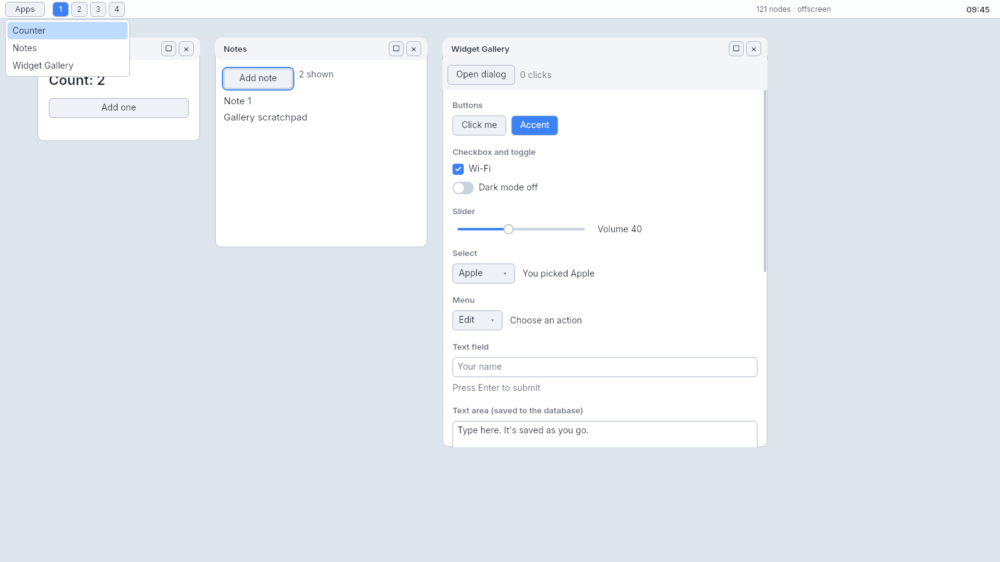
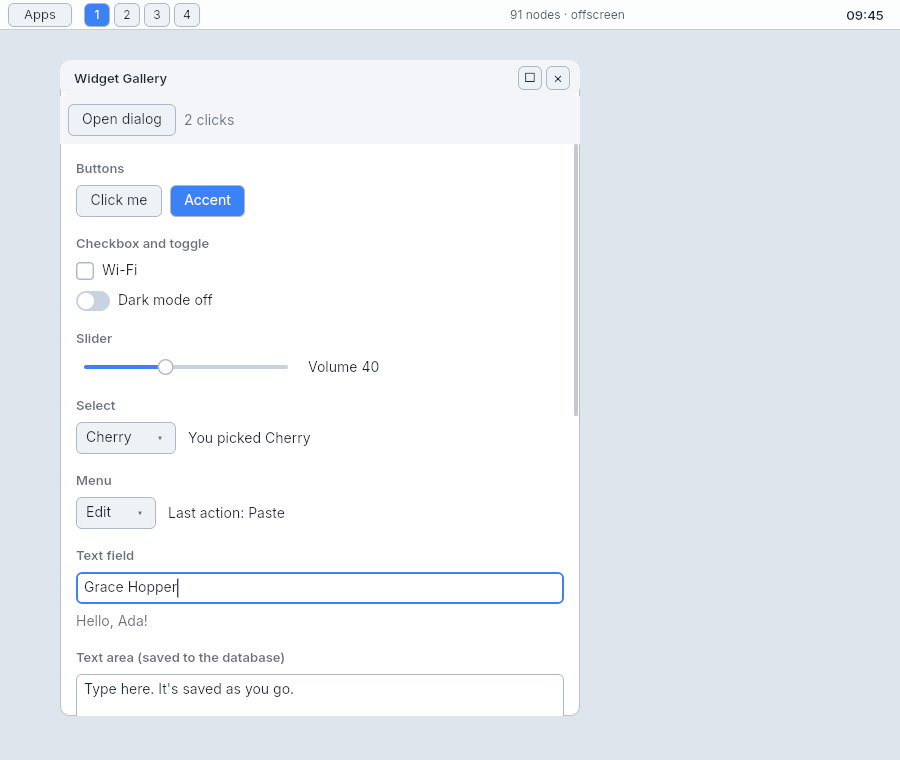
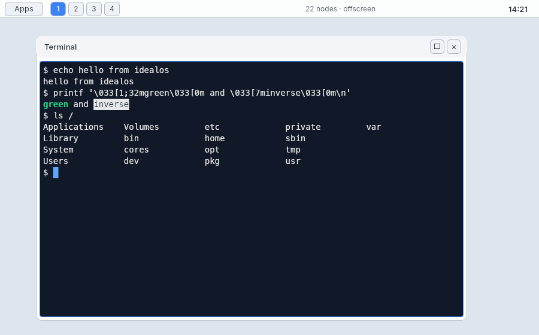
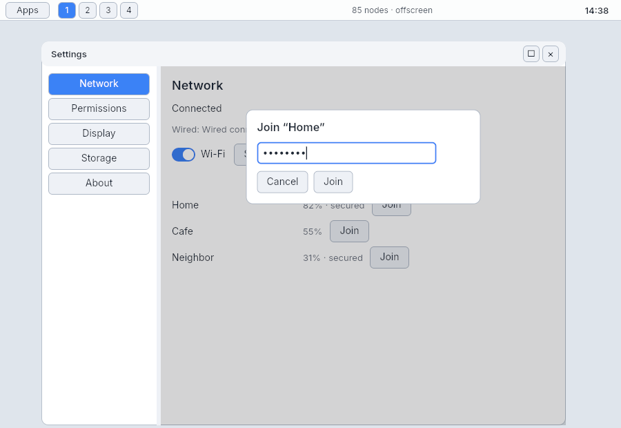
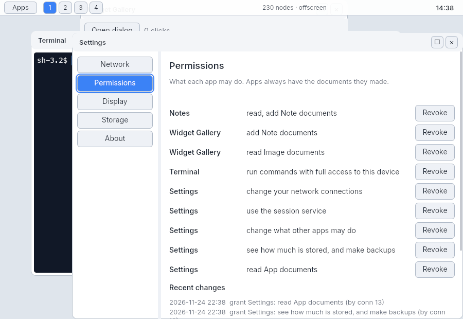
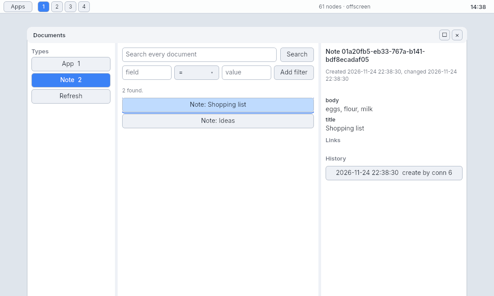

# idealos

A research desktop OS built around one question: what would a desktop look like if a
persistent, versioned, syncable database replaced the filesystem?

It is a minimal Linux with its own hardware-accelerated scene-graph compositor, a
message bus that brokers permissions, a CRDT document database, and TypeScript apps.
Targets: Raspberry Pi 4 (8 GB) and an aarch64 QEMU VM on Apple Silicon.

- [docs/feature-list.md](docs/feature-list.md): vision, decisions, architecture, risks
- [docs/implementation-plan.md](docs/implementation-plan.md): milestones M0–M14
- [docs/spikes.md](docs/spikes.md): spike results (database and QuickJS so far)


The same compositor on the QEMU image, through its KMS backend:
[docs/screenshots/m1-kms-qemu.png](docs/screenshots/m1-kms-qemu.png). Apps in
windows, with the widget set and the shell (M5):
[docs/screenshots/m5-desktop.png](docs/screenshots/m5-desktop.png).

## Quick start (macOS)

```sh
make hosted        # compositor demo in a window: drag title bars, click to raise, Option+Tab
make bench         # release build, redraws every frame, logs frame times
make text-bench    # a long document in a text area: ms per keystroke, caret move, scroll
make bus           # the message bus broker; then, in another terminal:
make bus-bench     #   round trip and throughput through it (osctl bus bench)
make spike-db      # Spike C: Loro + SQLite + FTS5 at 10,000 docs
make spike-js      # Spike D: memory and startup of 8 QuickJS app processes
make spike-kms     # Spike A: wgpu -> KMS on virtio-gpu in a QEMU VM (needs lima + qemu)
make screenshot    # render the demo offscreen to docs/screenshots/phase0.png
make test          # all Rust tests (includes a real GPU render-and-readback test)
make lint          # rustfmt, clippy, and the device-only compositor build
make lint-device   # clippy on the Linux-only KMS code, in the build VM
make sdk           # type-check the TypeScript SDK and run its tests
make apps          # bundle the apps in apps/ with esbuild (via npx)
make apps-check    # type-check and unit-test the apps that have tests
make tools-check   # type-check and unit-test the TypeScript tools in tools/
```

Apps on the Mac, in four terminals: `make bus`, `make db`, `make hosted`, then
`cargo build -p app-host && cargo run -p osctl -- app install --watch apps/notes`.
With no session on the bus, `osctl` runs the app itself, and `--watch` rebuilds
and restarts it whenever the app or the SDK changes.

Device images need two extra tools: `brew install lima qemu`.

```sh
make vm            # create the aarch64 Linux build VM (once)
make check-defconfigs  # seconds: fail if Buildroot would silently drop a defconfig option
make image-qemu    # Buildroot image for QEMU  -> image/output/qemu (first build ~3 h)
make smoke-qemu    # boot it headless and check it, input included (~20 s); exits 1 on any failure
make smoke-deploy  # ...then rebuild, deploy binaries and apps over SSH, check everything restarted from them
make smoke-report  # ...then run the Pi's first-boot hardware report against it
make qemu          # boot it; serial console here, display in a window
make image-rpi4    # Buildroot image for the Pi 4 -> image/output/rpi4
make image-rpi3    # ...or for a Pi 3, rendering in software -> image/output/rpi3 (first build ~2-3 h)
tools/flash-sd /dev/diskN        # write the Pi 4 image to an SD card (diskutil list external)
tools/flash-sd /dev/diskN rpi3   # ...or the Pi 3 image; both offer to preset Wi-Fi afterwards
tools/flash-sd /dev/diskN rpi3 MyWifi   # ...and preset that network without asking (prompts for its password)
tools/sd-wifi /dev/diskN [SSID [PASSWORD]]   # preset Wi-Fi on a flashed card: the Pi joins it on its next boot
make deploy HOST=192.168.1.50           # rebuild and push binaries and apps to a running dev image
make deploy HOST=localhost PORT=2222   # ...or to QEMU
make pi-state HOST=192.168.1.50         # what's running, power, network, display, kernel warnings, session's log
make pi-report HOST=192.168.1.50        # hardware report + Spike A-D numbers -> image/output/reports
```

The image doesn't answer mDNS, so `idealos.local` doesn't resolve: use the Pi's
address, which Settings → Network shows (or `ip -4 addr` in Terminal).

To reach a new Pi without Ethernet, preset Wi-Fi on the card: `tools/sd-wifi`
writes the network's name and password to `wifi.txt` on the boot partition, and at
boot `S05data` saves it as a NetworkManager profile on `/data` and deletes the file.
It's an ordinary saved network afterwards (Settings → Network can forget it).
Both scripts take the SSID and password as arguments, and ask for whichever is
missing. A password given as an argument lands in your shell history and is
visible in `ps` while the script runs, so leave it off to be asked instead (`""`
means an open network).

`tools/build-image` makes an SSH key, `image/output/dev-key`, and bakes its public
half into dev images as root's only login. `make deploy` uses it, so reflash after
deleting `image/output`. Deploy builds with the image's own Buildroot toolchain
(`make device-bins`), copies every service binary to the writable `/opt/idealos/bin`
overlay and every app bundle to `/opt/idealos/apps`, and sends `session` SIGTERM.
init restarts it; session and its services prefer the overlay's binaries, and at
boot `install-apps` installs the overlay's bundles over the image's. The overlay
lives on `/data`, so it survives reboots, and documents are untouched.

On a new board, run `make pi-report` first. It records the board, storage speed, DRM
cards and connectors, Vulkan drivers and input devices, then stops the desktop to run
kms-probe with two and three buffers (Spikes A/B), runs the compositor flat out for
10 s, runs both benchmarks (Spikes C and D), and restores the desktop. A copy stays
on the device in `/data/reports`.

To see what a running device is doing, run `make pi-state`, or `system-state` at its
console (`/usr/libexec/idealos`). It changes nothing. It shows:

- the board, CPU clock, temperature and any undervoltage;
- memory and storage;
- session's services, and any it gave up on;
- the network and the display;
- kernel warnings;
- the end of session's log.

That log, `/data/log/session.log`, holds everything session and its services print,
stamped with seconds since boot like `dmesg`. It moves to `session.log.1` at 1 MiB.
The console shell writes to the screen directly.

## Layout

```
crates/protocol     bus envelope and scene-graph ops (shared by Rust and, via sdk/, TypeScript)
crates/busd         message bus broker: routing, pub/sub, sender identity, permission hook
crates/bus-client   async Rust client for the bus
crates/osctl        command-line tool: osctl bus ..., db ..., app ..., perm ..., backup ...
crates/db           the document store: Loro, SQLite, queries, live queries, links, blobs, schemas
crates/dbd          the db service on the bus
crates/permd        the perm service: grants, the audit log, permission prompts
crates/secretsd     the secrets service: an encrypted store, per owner
crates/ptyd         the pty service: shells on pseudo-terminals, parsed into screens
crates/browser-host the web service: Servo draws pages into surfaces (builds outside the workspace)
crates/netd         the net service: Wi-Fi and connections, over NetworkManager
crates/backupd      the backup service: the database and its blobs to and from a USB drive
crates/audiod       the audio service: plays Track documents, gapless, and owns the queue
crates/importd      the import service: files from an SMB share (or a folder) into the database
crates/app-host     one app's process: its JavaScript in QuickJS, with the bus
crates/compositor   scene graph, wgpu renderer, window manager, hosted + KMS backends
crates/session      first process after init: starts and supervises services, sandboxes apps
crates/sandbox      the sandboxes session puts apps in and importd puts its file reader in
spikes/             db-bench (C), js-bench (D), kms-probe (A/B): benchmarks to rerun on the Pi
sdk/                @idealos/sdk: bus, database and live queries, signals, windows and widgets
apps/               the apps that ship with the system (counter, notes, gallery, terminal, settings, browser, editor, files, styles, music, web)
schemas/            JSON Schemas for the system document types
image/              Buildroot external tree: defconfigs, kernel fragments, rootfs overlay
tools/              build VM, image build, QEMU, SD card, deploy scripts
docs/               feature list, implementation plan, architecture.html (an interactive map), screenshots
```

## Status: Phase 0

| Item | State |
| --- | --- |
| Monorepo, Makefile, CI workflow | Done. CI runs on GitHub (`IdealOS/m7`) and passes. |
| `protocol`: bus envelope, framing, scene ops | Done, tested against the plan's JSON examples |
| Compositor scene graph (groups, rects, text, clipping) | Done, tested |
| Renderer: instanced SDF rounded rects, glyphon text per layer | Done; renders at 60 fps hosted on an M3 |
| Window manager v0: raise on click, drag by title bar, Alt+Tab | Done, tested. Both backends feed one `Seat`, so mouse, tablet and keyboard drive the same code. |
| Damage tracking | **Region damage works** (`damage.rs`): each frame's draw list is compared with the last one, layer by layer (a window and its dialogs), and only the rectangles that changed are redrawn, clipped with scissor rects (at most 4; past 60% of the screen it redraws everything). With direct scanout each buffer remembers which frames it missed, so a buffer that comes back three frames old gets three frames of damage. An idle scene draws nothing. A partial frame matches a full one pixel for pixel (a test). Not yet: a debug overlay showing the damage. |
| Headless render to PNG | Done (screenshots, future golden-image tests) |
| `session` supervisor with restart backoff | Done, tested on macOS. Stops its services on SIGTERM (SIGKILL after 2 s), so a restart leaves nothing behind. Gives up on a service that fails 5 times in a row without running a minute (a missing driver won't fix itself, and the restarts would bury the console shell); `launch` retries an app, and restarting session retries everything. With `log PATH` in `session.conf`, everything session and its services print also goes to that file, stamped with the time since boot (the image: `/data/log/session.log`, readable by root only, capped at two 1 MiB files); `console` services, such as the console shell, keep the terminal. Tested end to end on macOS and on a Pi 3B+. |
| Fonts | Inter (variable, SIL OFL) is built into the compositor as the sans-serif face on every target. A style's `font-family` can name any family installed on the device, falling back along its list to `sans-serif`, `serif` or `monospace`; on the image those are the DejaVu families, so the terminal draws in DejaVu Sans Mono. Local fonts only: nothing is downloaded, and apps can't bring their own yet (a font file is parsed inside the trusted compositor). |
| Images, transforms beyond translation | Not started. |
| KMS backend | **Output and input work** (M1): `compositor --backend kms` draws the scene with three page-flipped dumb buffers (Spike A's copy path), redraws only when the scene changes, and takes keyboard and pointer input through libinput and xkbcommon. The pointer is a hardware cursor, so moving it costs no redraw (checked by eye in QEMU's window; screendumps leave it out). It picks the first DRM card with a connected display (on a Pi 4, `vc4`, not `v3d`). While it runs, the text console's keyboard and drawing are off, so keys don't also reach the console (on the Pi, a root shell); it exits cleanly on SIGTERM and gives them back. Mesa's shader cache lives on `/data/cache`. **Direct scanout** (Spike B, `--scanout`): where the GPU can import dma-bufs, the dumb buffers are exported and imported into V3DV, and frames are drawn straight into them, with no readback or copy. On a Pi 4 at 3440x1440 a frame went from 125 ms to 57 ms (window drags from 7 to 17 fps); lavapipe (QEMU, the Pi 3) keeps the copy path. A plain full-screen background is now the frame's clear colour, which a tiled GPU applies for free, not a quad shaded on every pixel: that took another ~22 ms off every frame. An empty desktop draws in 7 ms (60 fps), and each window adds about 1 ms; the demo's 20 windows drag at 28 fps. **Region damage** then brought a drag to 35 fps with 20 windows and 33 fps with 40, redrawing about 4% of the screen a frame. What's left is a fixed ~13 ms: a partial frame keeps the old pixels, and a tiled GPU then loads and stores every tile of the screen, which wgpu gives no way to limit to the damage. On the copy path only the damage is drawn, but the whole frame is still read back and copied. |
| Buildroot image for QEMU | **Built and booted** (Buildroot 2026.08.2, kernel 6.12.58). Boots to `session` in ~0.4 s under HVF; `/data` and the dev overlay mount; the compositor shows its first frame on virtio-gpu (lavapipe), finds QEMU's virtio keyboard and tablet, and moves a window dragged by its title bar and raises the next on Alt+Tab. `make smoke-qemu` checks all of this. |
| Buildroot image for the Pi 4 | **Built** on the first try (~45 min, reusing downloads): Pi kernel `stable_20250916`, V3DV Vulkan driver, firmware with the `vc4-kms-v3d-pi4` overlay, and the dev SSH key, in a 3.3 GB `sdcard.img`. **Boots on a Pi 4 Model B (2 GB, rev 1.5)** to the desktop in 6.8 s, joins Wi-Fi from a preset, takes SSH, deploys and pi-report. The compositor renders on the GPU (V3D 4.2, V3DV) with direct scanout; the desktop uses 161 MB of memory, with 445 of the 512 MB GPU pool free. `post-image.sh` also checks for `v3d` (built into the kernel): the image has no software renderer to fall back on. On a 3440x1440 monitor the picture once dropped out after a while: that mode needs a faster core clock than the default, so `config.txt` sets `hdmi_enable_4kp60=1` (not yet tried on the board; the Pi runs a little warmer for it). |
| Buildroot image for the Pi 3 | A stand-in until a Pi 4 is on hand (`make image-rpi3`): the same kernel, partitions, services and apps, with Pi 3 firmware (`bootcode.bin`, `start.elf`), the 3B and 3B+ device trees and the `vc4-kms-v3d` overlay. The Pi 3's GPU has no Vulkan driver, so the compositor renders with lavapipe, as under QEMU: slower, and no measure of the Pi 4's GPU path. 1 GB of memory. **Boots on a Pi 3B+** to the desktop on 1080p HDMI, joins Wi-Fi from a preset, and takes SSH and `make deploy`. Its drivers are xz-compressed modules, so the image builds host and target kmod with xz and uses kmod's `modprobe` (the kernel runs it to load `brcmfmac-wcc`); `post-image.sh` fails the build if `vc4` or `brcmfmac` is missing from `modules.dep`. A 1080p frame takes about 250 ms (4 fps at best). Rendering 720 rows and letting the display scale them up (`compositor --render-height 720`) made text fuzzy without a visible speed-up, so it's opt-in; an OpenGL ES 2.0 renderer is filed under Future projects in the plan. |
| Lima build VM, image build, QEMU boot | Run end to end. |
| SSH deploy | **Works against QEMU**: `make smoke-deploy` rebuilds, pushes every service binary and app bundle, and checks that session, each service and the apps restarted from the overlay with the old shell gone. Also run against a Pi 3B+ over Wi-Fi. |
| Hardware report (`make pi-report`) | **Works against QEMU**: `make smoke-report` runs it end to end and checks every section, both kms-probe runs, the compositor finding input, both benchmark tables, and that the desktop comes back. **Run on a Pi 3B+**: all sections completed (kms-probe, the compositor, both benchmarks), and the desktop came back. **And on a Pi 4**, with the direct-scanout probe beside the copy path. |
| SD card flashing | **Works**: `tools/flash-sd` wrote the Pi 4 image to a 15.5 GB card, and its four partitions read back on the Mac. `tools/sd-wifi` (Wi-Fi preset) tested against a copy of the image attached as a disk; the Pi side, against QEMU's NetworkManager in `make smoke-qemu`, and on a Pi 3B+, which joined the preset network on first boot. Both scripts take the SSID and password as arguments. After writing, `flash-sd` reads back the partition table and 16 MB of the root partition and compares them with the image (not the boot partition, which macOS mounts and writes to): it caught a card that took a whole image and kept none of it. |

### Message bus (M2)

| Item | State |
| --- | --- |
| `busd` broker | **Works** on macOS and in the QEMU image, where session starts it on `/run/idealos/bus.sock` and `make smoke-qemu` sends a request through it. Routes requests by service name and rewrites request ids, so two clients can both use id 1. A request ends with exactly one answer: the service's, a broker `timeout` (default 30 s, or `timeout_ms`), `service_gone`, or nothing after the caller cancels. Also handles pub/sub with `prefix.*` wildcards, and stamps every message with its sender (a client's own `from` is dropped). Each connection's outgoing queue is bounded at 4096 frames, 16 MiB and 256 descriptors; a connection that stops reading is dropped, except a tap, which just misses trace messages. Each connection may also have at most 1,024 requests waiting for answers, 256 subscriptions and 64 names (past them the broker answers `limit_exceeded`), and a request waits at most an hour. A **streamed request** (`"stream": true`) instead gets any number of `stream` frames from the service before its response, has no timeout, and ends when the service responds, the caller cancels, or either side disconnects (each connection may have 256 open, apart from the 1,024). It raises its own open-descriptor limit at startup (the default is 1,024). The permission hook follows the grants permd publishes (M6, below). |
| Who may connect | Through the socket: only the broker's own user or root, checked with peer credentials, in an owner-only directory; these connections are trusted (they may claim service names and tap the bus). **Identity by construction:** session starts `busd` with session's own connection already in place (`bus=broker` in `session.conf`), and for each `bus=system` or `bus=app:ID` service makes a socket pair, gives the service one end (`IDEALOS_BUS_FD`) and hands the broker the other with `adopt`, which only session may call. An app's messages are stamped with its app id; it can't claim names or tap. If `busd` dies, session restarts it and the services that had connections. An app can't reach the socket itself: its sandbox (M6) allows it no new sockets. |
| File descriptors | Requests, responses and publishes can carry up to 16 (`SCM_RIGHTS`), declared as `"fds": n`; each subscriber gets its own copies. A message whose descriptors didn't arrive drops the connection. |
| `bus-client` | Async Rust client: typed `hello`, `list`, `claim` and `release`, requests (dropping one before it finishes cancels it), streamed requests (dropping the stream cancels it), subscriptions (dropping the last one on a pattern unsubscribes), publishing, serving claimed names (and streaming answers), and descriptors on all of them. It refuses to send a message over the broker's 4 MiB frame limit (`limit_exceeded`) rather than lose the connection. Uses the connection session handed over when there is one. |
| `osctl bus` | `list`, `hello`, `call`, `stream` (a streamed request, one JSON line per part), `pub`, `sub`, `tap` (a live trace of every message), `echo` (a test service), `bench`. |
| Benchmarks | `osctl bus bench`, through a running broker. Apple M3 Mac (release build): 37.5 µs round trip p50, 290,000 requests/s with 64 in flight, 1.24 million publishes/s. QEMU image on the same Mac (`make smoke-report`, 3 s runs): 18.5 µs p50, 262,000 requests/s and 1.47 million publishes/s with 64-byte payloads; 47.7 µs, 124,000 requests/s and 237,000 publishes/s with 4 KiB. `make smoke-qemu` checks a 1 s run. `make pi-report` runs it on a Pi; not yet run there. |
| Schema and TypeScript types | `crates/protocol-schema` exports the wire types (and the protocol's constants and broker error codes) as JSON Schema to `crates/protocol/schema.json`, and `tools/gen-protocol.ts` generates `sdk/src/protocol.ts` from it; `make protocol` does both. The broker's own methods (`hello`, `claim`, `release`, `list`, `adopt`) and the tap's trace events have typed params and results in `protocol::broker`, exported the same way. A Rust test and a tools test fail when either file is out of date. The generator fails on any schema it doesn't understand instead of writing `unknown`. |
| Randomized tests | Seeded, dependency-free, and part of `cargo test`: the router gets random traffic across connections that open, close and get adopted, with its tables checked after every event and every forwarded request checked to end exactly once, answered only by the service it went to, with stream frames reaching only the requester of an open streamed request; the frame decoder gets random and damaged frames; a live broker gets garbage from 64 connections at once and must keep serving and forget them all. `BUS_FUZZ_SEEDS=n` runs longer: 100,000 router seeds (200 million events) and 50 million damaged frames pass. Planted router bugs are caught. No coverage-guided fuzzing yet (`cargo-fuzz` needs a newer nightly than this machine has). |

### Database (M3)

| Item | State |
| --- | --- |
| Document store (`crates/db`) | **Works** on macOS. Each document is a Loro document; one SQLite transaction (WAL) per change writes its snapshot or incremental update, a JSON copy for queries and an FTS5 row for search, as Spike C measured. Updates are JSON merge patches that write only what changed; updates are folded into the snapshot every 64. Every change belongs to a change set recording when and who. Deleting keeps the state for history. Documents are at most 1 MiB of JSON. |
| Queries | A Mongo-style filter (`$eq`, `$ne`, `$gt`/`$gte`/`$lt`/`$lte`, `$in`, `$nin`, `$exists`, `$contains`, `$and`, `$or`, `$not`, and the link operators below) compiled to SQL. Field paths are validated and inlined so expression indexes match (a test checks the query plan); values are always bound. Comparisons are typed. A reference evaluator agrees with the SQL on random documents and filters (100,000 filters pass). Search matches every word, with FTS5 syntax treated as text. |
| `dbd` (the `db` service) | Serves documents, queries, search, history, `watch`, links, snapshots and blobs on the bus; records each change under the caller's stamped identity. Session starts it as a system service; on the device the database is `/data/db/idealos.db`, with `snapshots/` and `blobs/` beside it. `make db` runs it on the Mac. |
| History and undo | Every change set's effect on each document is kept as Loro versions. `history` lists a document's changes, `at` reads it as of any of them (even after compaction), and `diff` lists the fields that differ between two. `undo` reverts a change set with a new one, so the undo is in history too and undoing it redoes: an update's fields go back (later changes to other fields stay), a create is deleted, a delete restored. A randomized test checks this against a model (1,000 seeds pass). |
| Live queries | `watch` takes a query as a streamed request. The first part is the result; each later part is a diff (`added`, `changed`, `removed`, and the full `order` whenever something was added or moved). Writes collect for 16 ms, so a burst of writes is one part (21 writes arrived as 2 in the test). Then a live query re-runs only if a changed document was in its last result or matches its filter now, checked with the query's own SQL limited to the changed rows (queries with an offset always re-run): in the benchmark, 2,036 of 2,500 candidate re-runs were skipped, and refreshing 20 live queries after a write fell from 126 ms to under 1.5 ms on the Mac. Cancelling or disconnecting stops it; dbd keeps at most 4,096. A randomized test applies every part to a client's copy and checks it against running the query again (2,000 seeds pass, including offsets, and planted bugs in the diff and in the skip rule are caught). Not yet: sharing one run between identical queries. |
| Links | A field whose value is `{"$link": "<id>"}` links to that document. Links live in the document's data, so history, undo and sync carry them; each write also rewrites the document's rows in a `links` table (schema version 3), so they're followed both ways: `links` lists a document's links out and in (and whether each target exists), and filters match `{"from": {"$link": id}}` (that field, a field under it or an item of it), `{"$linksTo": id}` and `{"$linkedFrom": id}`. Targets may be missing; a deleted document's links leave until it's restored. A randomized test checks the table always matches the documents through creates, updates, deletes and undos. Graph queries are one hop for now. |
| Blobs | Immutable files named by their SHA-256 (`blobs/ab/cdef…`, read-only), stored once however often they're added. `put_blob` takes a regular file or memfd as a passed descriptor and is read off the store's thread; `get_blob` answers with a read-only descriptor. Documents refer to them with `{"$blob": "<hash>"}`, only to stored ones, and `blob_info` counts the live references. SHA-256 is our own 120 lines, checked against the NIST vectors, instead of a dependency. Each version records the blobs it uses, so history compaction can delete the ones nothing needs. |
| System schemas | `schemas/` holds JSON Schemas for App, Contact, Email, Image, Message, Playlist, Setting, StyleSheet, TextDocument and Track. Writes of those types are checked (unknown fields allowed; other types are free-form), and each schema's `x-indexes` become `(type, field)` expression indexes, which the compiled queries use. dbd checks the subset of JSON Schema they use itself, and a schema using anything else fails a test, so no keyword is silently ignored. `schemas` returns them. |
| History compaction | **Built** (M8): dbd runs it daily, and `osctl db compact` runs it now. Everything from the last 30 days stays; older, a document keeps its last version of each day, and after a year, of each week; creations and pinned versions (`osctl db pin`) always stay. Then blobs no live document and no kept version uses are deleted, after a day's grace for uploads, along with blob files the database never recorded. Loro keeps every edit, so documents don't shrink: the space comes back from blobs. History dated before 2025 (written while the Pi's clock was unset) is never thinned. Because weekly versions are kept for good, what it frees is blobs that were only ever in versions it thinned out (a photo replaced the same day, say); a blob in any kept version stays. Not yet: a way to purge, so deleted documents keep their blobs forever, for undo. |
| Backups | **Built** (M8): `backupd` copies the database and its blobs to a USB drive formatted as exFAT, and restores them. A drive becomes a backup drive in Settings > Backup (or `osctl backup setup sda1`), which puts an `idealos-backup` folder on it; a backup starts then, whenever one is plugged in and its newest backup is over an hour old, and daily while it stays in. Each backup is a fresh dbd snapshot plus the blobs it records that the drive doesn't have yet, so later backups copy only what's new; blobs are checked against their SHA-256 both ways, and a database copy is checked before it's kept. Each device keeps its newest 30 backups on a drive (several devices can share one), and blobs no kept backup records are deleted. Restoring copies the blobs back, then has dbd restore the database (the state it replaces is kept as a snapshot); a backup of another device makes this device that one, which is how a new SD card gets an old one's data back. The drive is mounted only while it's being read or written. Backups hold documents and blobs only, not secrets or Wi-Fi passwords, and aren't encrypted yet. Tested end to end against a directory standing in for the drive, and in QEMU against an exFAT disk. |
| Imports | **Started** (M14): `importd` copies files into the database as typed documents: `.txt` and `.md` as `TextDocument`s, pictures as `Image`s with their bytes as blobs, music as `Track`s with their tags (lofty), length and embedded cover. Files come from an SMB share by address (`smb://user@host[:port]/share`, mounted read-only with the kernel's CIFS client only while in use, its password kept in secretsd), or, for development, a folder under importd's `--dir`. Each document records where it came from and the file's hash, so importing again skips what's there. `osctl import login`, `browse`, `run` and `status` drive it. Tried against macOS File Sharing from QEMU (a Mac account needs Windows File Sharing ticked in its File Sharing options). Each import is one change set, so it undoes in one step. The **Files** app (`apps/files`) browses a share, asks for its password once, and imports ticked files or folders with progress and an Undo button. importd runs as root (mounting needs it), so it decodes nothing itself: music tags and picture sizes are read by `import-reader`, from files importd opens and passes it, in the tightest sandbox (its own Unix user, no network, no file it may open, nowhere to write, 256 MB of memory, 30 s a file). A reader that crashes or hangs fails that one file, and importd checks every field it answers. Files are opened with `openat2`, so no symbolic link on a share leads anywhere else. |
| Music playback | **Started** (M11): `audiod` plays `Track` documents and owns the queue (play, pause, next, previous, seek, volume, shuffle, repeat, play next), so music keeps playing with no app open; apps, the top bar and `osctl audio` are remote controls that follow `watch`. It reads each track's blob from the open file db hands over, decodes it with symphonia (MP3, AAC, ALAC, FLAC, Vorbis, WAV, AIFF), converts it to the output's rate with its own windowed-sinc resampler, and plays it through ALSA (CoreAudio on a Mac, so `make audio` plays through its speakers) with cpal. Tracks join without a gap, sample-exact, even across sample rates; one heard to its end gets its `playCount` and `lastPlayed` updated. With no sound device it plays silently, keeping time. Settings > Sound picks the output (one per sound card) and levels loudness from each track's ReplayGain tags, by song or by album; audiod follows both settings as they change, without losing its place. In the image it plays through ALSA: in QEMU to virtio-snd, which `tools/run-qemu` plays through the Mac; on the Pi 4 to HDMI or the headphone jack (not yet tried on hardware). The **Music** app (`apps/music`) browses albums, artists, genres, years and songs with a search, plays an album or a song, and follows audiod in a bar along the bottom (position, shuffle, repeat, volume) and a Now Playing page (a large cover, where the track is and the controls, with Up Next beside it; the bar's cover opens it); each track can be rated from one to five stars, and playlists are `Playlist` documents: the listener's own, which link to tracks in an order they choose (add from any song's menu or an album, move up and down, remove, rename, delete with undo), and smart playlists, whose rule (rating, when added, played or not, artist, genre, order, how many) is a live query that keeps itself current; five come built in (Top rated, Recently added, Never played, Most played, Recently played). It holds `Track` read and write (for ratings), `Playlist` read, write and create, and `service:audio`, and audiod reads tracks as the app. The top bar has a media control the compositor draws (previous, play or pause, next, and what's playing, which opens Music when clicked), and the keyboard's media keys (play/pause, next, previous, stop, volume, mute) go to audiod wherever the focus is, with Music closed; no app sees them. Not yet: choosing the output, and reordering playlists by dragging. |
| Snapshots | dbd takes one an hour (none if nothing changed) with SQLite's online backup API, keeping 48; `snapshot` takes one now and `snapshots` lists them. `restore` copies one back over the live database after saving the current state as a snapshot, so a restore can be undone; it refuses damaged snapshots, ones from a newer build and ones from another device (unless restoring a backup, which adopts it), migrates older ones, and live queries re-run against the restored data. |
| `osctl db` | `create`, `get`, `update`, `delete`, `query`, `search`, `history`, `at`, `diff`, `changes`, `undo`, `watch` (prints the parts as JSON lines; `--count N` stops after N), `link`, `links`, `schemas`, `snapshot`, `snapshots`, `restore`, `put-blob`, `get-blob`, `blob-info`. |
| Benchmark (`make db-bench`) | `store-bench` fills a fresh store with 10,000 emails (~2 KB bodies, each linked to a Contact) and times creates, updates, old versions, undo, live query refreshes, queries through the filter language and schema indexes, link queries, search, snapshots and blobs, checking the copies agree. `make pi-report` runs it on the device. Apple M3 Mac: create 0.44 ms and update 0.39 ms p50; inbox query 0.6 ms; all 825 mail from one sender 13 ms; rare-word search 0.3 ms; snapshot of the 96 MB database 0.25 s; blobs at 150 MB/s. The QEMU image on the same Mac (`make smoke-report`, which runs it through the hardware report): create 0.25 ms, update 0.28 ms, live refresh after a write 1.1 ms, all mail from one sender 8.7 ms, snapshot 0.1 s. SQLite's planner needs statistics to pick the right expression index (one query went from 38 ms to 13 ms), so the store runs `PRAGMA optimize` when it opens and dbd hourly. |
| Not done | The Pi benchmark (no Pi yet). |
| Collaborative text | `splice` (M5) edits a string field as Loro text: an insert and delete at a character position, which merges with other edits instead of replacing the string. |

### App runtime (M4)

| Item | State |
| --- | --- |
| Compositor on the bus | **Works** hosted and in the QEMU image. It claims `compositor` on a bus thread that hands requests to the frame loop and wakes it (a winit user event hosted, a socket pair in the KMS loop's `poll`), so rendering never waits on I/O. `open_window` is a streamed request: its first part names the window, later parts are the window's events, and the window lasts exactly as long as the request, so an app that exits or crashes leaves nothing behind. Each window gets a frame the compositor draws (title, close button) and a content area. Apps name nodes with their own ids, translated per window, so an app reaches only its own nodes; a commit is checked whole before any of it applies, only the window's opener may commit to it, and a window holds at most 20,000 nodes. |
| Widgets so far | `vstack` and `hstack` lay out their children (`gap`, `padding`, sizes from props or content); `label`; `button`, drawn pressed while held, with clicks sent to the app; `rect`, `text`, `group`. Presses go to the topmost window only. New windows open side by side, then in rows. M5 replaced this with taffy layout and the full widget set (below). |
| `app-host` | One process per app: QuickJS (rquickjs) runs the app's bundle as an ES module after a prelude that provides `console`, timers and `__idealos` (requests, streamed requests and cancels on the bus). Everything runs on one thread; JavaScript and Rust exchange only ids and JSON. It ends when the app exits or has nothing left to wait for; errors in callbacks are logged and the app carries on. 256 MB heap limit. |
| `@idealos/sdk` | `request`/`stream`; `db` (`query`, `get`, `put`, `update`, `remove`, `search`, and `live`, a signal that follows `watch`); SolidJS-style `signal`, `effect`, `memo`, `batch`, `root`; `openWindow`, `vstack`, `hstack`, `label`, `button`, `rect`, and `each` for keyed lists. UI is built once; function-valued props are reactive, only changed values are sent, and ops go out as one commit per microtask. Tested against a fake app-host (`sdk/check`). |
| Apps | `apps/counter` and `apps/notes` (a live list of Notes that can add one). `tools/build-app.ts` bundles an app with esbuild (via npx, pinned to 0.28.2, so nothing is installed in the repo) into `dist/app.js` and `dist/manifest.json`. |
| Installing and launching | An installed app is an `App` document whose bundle is a blob. `osctl app install DIR [--watch]` builds, installs and asks session to `launch` it; session runs `app-host --app ID` with an `app:ID` bus connection and restarts it like a service (`stop` and `apps` too; only trusted connections may call them). The image ships the apps under `/usr/share/idealos/apps`; `app-host --install` puts them in the database at boot and launches the autostart ones. |
| Tests | An end-to-end test runs a real broker, dbd, the compositor's bus bridge and an app in app-host, clicks the app's button through the compositor's input path and reads the result off the scene. Visual check: `compositor --screenshot out.png --serve-for N --click LABEL` serves app windows on the bus, presses buttons and renders. The QEMU smoke test checks that session runs both apps and that they opened their windows under their own app ids. |
| Not done | Memory per app process on the Pi (no Pi yet). App bundles aren't signed. |

### Widgets and window manager (M5)

| Item | State |
| --- | --- |
| Layout | **taffy** (flexbox and grid) lays out every container: `vstack`, `hstack`, `toolbar`, `grid` (`columns`), `split`, `scroll` and `dialog`, with `gap`, `padding`, `align`, fixed or percentage sizes, and `grow`. Text is measured with cosmic-text using the renderer's own metrics, so what's measured is what's drawn. Layout runs only when a commit changes something that affects it; colors, pressed states, carets and scroll offsets skip it. |
| Widgets | `label`, `button`, `checkbox`, `toggle`, `slider`, `select` (a menu of options that keeps a value), `menu` (a button that opens a menu of actions; for both, click to open and click an item, or press, drag to an item and let go, and the item under the pointer is highlighted), `text_field`, `text_area` (multiline, wrapping), `image` (a PNG or JPEG blob; a JPEG over 4096 px on a side is scaled down by a power of two while decoding, and a photo is turned upright as its EXIF orientation says), `scroll` (wheel, trackpad, and a draggable thumb that widens on hover; dragging the content itself, with kinetic coasting, is for touchscreens, which no backend reports yet), `vlist` (a virtual list: the app makes only the rows in view, told which by `range` events), `split` (a draggable divider, highlighted on hover with a resize cursor), `toolbar` and `dialog` (modal within its window; Escape cancels). The compositor draws and drives them all: typing, dragging a slider, scrolling and opening menus never wait on the app, which hears `click`, `change`, `submit`, `choose`, `range` and `cancel` events. Widget state the compositor owns (focus, caret, selection, scroll position) lives in `_`-prefixed props that apps can't set. |
| Focus and keyboard | Clicking focuses a widget; Tab and Shift+Tab move through a window's focusable widgets in order; focus is drawn as a ring. Space or Enter works buttons, checkboxes, toggles, selects and menus; arrows, Page Up/Down, Home and End move sliders and selects; text widgets have caret movement, selection (Shift+arrows, drag, Cmd/Super+A) and cut, copy and paste with Cmd/Super or Ctrl. They take the macOS and Emacs keys: Ctrl-A/E (line start and end), Ctrl-F/B/N/P (moving), Ctrl-D/H (delete forward and back), Ctrl-K (cut to the line's end) and Ctrl-Y (put it back), Ctrl-T (swap characters); Option or Ctrl with arrows and Backspace or Delete work by word; Cmd with Left/Right goes to the line's ends, with Up/Down to the text's (in a text area Cmd-Up no longer maximizes the window; Ctrl-Alt-Up does), and Cmd-Backspace deletes to the line's start; Option-Up/Down go by paragraph and Page Up/Down by a view; Home and End go to the line's ends. Cmd-Z and Cmd-Shift-Z undo and redo a bound field's edits (`texthistory.rs`): typing in a run undoes together, and each step undoes db change sets. Apps can hear and set the caret and selection, focus a field, and add their own change sets to its undo history. |
| Bound text | A `text_field` or `text_area` with `bind: {doc, path}` edits that document field directly: the compositor loads it from `dbd` and sends each edit as a `splice` (insert and delete at a character position), which dbd applies to the field as Loro collaborative text, with no round trip through the app. An end-to-end test types into a bound text area, restarts dbd, the compositor and the app, and finds the text again. The field follows its document with a live query (M9), so another window, a restore or `osctl` changes it too, with the caret kept on its character. |
| Long text | **Built** (M9): text is shaped and laid out a paragraph at a time (`crates/compositor/src/paragraphs.rs`), keeping each paragraph's layout between frames. Typing reshapes only the paragraph typed in, and only the paragraphs on screen and above them are laid out: what's further down waits until it's scrolled to, and the scroll limit estimates its height until then. `make text-bench`, Apple M3, a 200 KB document (570 paragraphs): a keystroke 127 → 0.45 ms, caret down 199 → 0.4 ms, caret right 65 → 0.3 ms, opening 62 → 1.4 ms, the first scroll 66 → 2.2 ms (desktop plus drawing). Not yet measured on a Pi. |
| Clipboard | Owned by the compositor: text plus an optional document reference. Text widgets use it directly; apps read and write it with `get_clipboard` and `set_clipboard` (`clipboard()` and `setClipboard()` in the SDK). |
| Window manager | Compositor-drawn title bars with close and maximize buttons; the active window's title bar stands out, and title bars show hover and pressed states (all styled by `.titlebar` and `.window-title` in the system sheet). Drag the title bar to move, any edge or corner to resize (the pointer turns into a resize arrow there; the zone is mostly just outside the window, so a scrollbar at its edge still works; the app hears the new size once, as `resized`), and maximize with the button, Ctrl+Alt+Up or Logo+Up. Clicking raises and focuses a window. Four workspaces: Ctrl+Alt+Left/Right or Ctrl+Alt+1–4 switch, and adding Shift takes the top window along; new windows open on the current one. Alt+Tab (or Logo+Tab) raises the next window and briefly shows a switcher listing them. |
| Shell | In the top bar: an Apps button whose menu lists the installed `App` documents and launches the one chosen (through session), one button per workspace with the current one highlighted, a media control while something is queued (see Music playback), and a clock in local time. |
| Styles and themes | **Built**: CSS-like style sheets for colours and fonts only (`crates/compositor/src/style.rs`). A selector is a widget kind, a `.class` (from a node's `class` prop) or both, with at most one state (`:hover`, `:pressed`, `:focus`, `:disabled`, `:checked`); no combinators, so a rule never depends on where a node sits. Variables (`--accent`, `var(--accent)`, or `$accent` in a colour prop) hold colours; `color`, `accent-color` and fonts inherit down the tree. The system sheet (`system.css`) styles every widget and the compositor's own chrome, with a dark theme in `@dark`; an app can send its own sheet with `openWindow({ style })` (`import style from "./style.css"`), which applies only inside its windows and never to the frame or prompts. The more specific rule wins, then the app's, then the later one; a node's own colour props beat both. A mistake fails `openWindow` with its line and column. Settings > Display switches between light and dark: it writes the `appearance.theme` setting, which the compositor follows with a live query, so every window restyles at once (`compositor --theme dark` picks the starting theme). Hovering a button, select, menu, checkbox, toggle or slider shows its `:hover` colours, and in an open menu or select list the item under the pointer is highlighted. Spacing, sizes and radii stay in `theme.rs`. |
| Live style editing | **Built**: edits to a style sheet are a `StyleSheet` document (`target` is `system` or `app:<id>`) that the compositor follows with a live query, so each change restyles the screen as it's typed, with history and undo. Edits come after the built-in system sheet or the app's own, so they override them; an empty sheet puts things back. A sheet with a mistake isn't applied (the last good one stays). The **Style Editor** app binds its text area straight to the document (which it then follows, so `osctl` and `style-watch` edits show in it) and shows whether the sheet parses and where a mistake is, beside a preview of the widgets. `osctl style get/set/check/reset` works on the device, and `make style-watch HOST=localhost:2222 FILE=my.css` sends a file from the Mac each time it's saved. The permission prompt always keeps the built-in look. |
| Transitions | **Built**, without window textures (`crates/compositor/src/anim.rs`): the compositor moves positions and colours to where they're set instead of jumping, so motion never waits on an app. A node's `transition` prop names the props that move and for how long, `{x: 200, color: [150, "ease-in-out"]}` (`x`, `y`, `color`, `text_color`, `border_color`); the prop holds the end value and drawing shows where it is now. A widget's style colours fade when its state changes (hover, focus, and letting go of a press: 120 ms; a press itself shows at once) and when the theme switches (250 ms, the chrome included). The window manager slides windows in when switching workspaces, a new window rises into place, and menus, the window switcher and dialog backdrops fade in. Colours move in Oklab, so fades look even. A value retargeted mid-way starts from where it is, and region damage redraws only what moved. The KMS backend samples motion at the next vblank (from the page-flip timestamps), so it stays smooth when a frame starts late. Settings > Display has **Reduce motion** (`appearance.reduce_motion`), which makes every change instant. Not yet: size, scale, whole-window fades, open and close animations and blur, which need windows drawn as textures. |
| Gallery app | `apps/gallery` shows every widget, with a text area bound to a "Gallery scratchpad" note. It's installed in the image but doesn't start on its own: launch it from the Apps menu. Visual check: `compositor --screenshot out.png --serve-for N` now also takes `--type TEXT`, `--key NAME` and `--scroll PX` steps beside `--click LABEL`. |
| Editor app | **Built** (M9): `apps/editor` writes `TextDocument`s. The title and body are bound to the document, so there's no Save: each keystroke is stored as collaborative text, with history. On the left, the documents, most recently changed first (`orderBy: [["$updated", "desc"]]`), a full-text search, and filters by format and tag; on the right, the one open. Find and replace (match case, whole word; Replace all is one Cmd-Z). Word and character counts and the caret's line and column. A history panel: a timeline of every version, what each change did, restoring one (as splices, so it can be undone), and pinning versions by name. For Markdown, a preview beside the text (headings, lists, quotes, code, rules, images; inline marks shown as plain text until text widgets can mix styles), links to other documents (`[text](doc:<id>)`, kept in a `links` field so backlinks show as "Linked from"), and images stored as blobs. Sans, serif and monospace modes, and a focus mode with only the page. Delete can be undone. |
| SDK | Builders for every widget above, `onChange`/`onSubmit`/`onChoose`/`onCancel`/`onRange` handlers, `virtualList({count, rowHeight, overscan}, render)`, and a window `size()` that follows resizes. |
| Not done | Only PNG and JPEG images (a PNG at most 4096 px on a side). The clipboard lives in memory; reading it takes the `clipboard` grant (M6). The KMS backend's new keyboard, wheel and wake handling is checked by clippy and the QEMU smoke test, not by hand on a Pi. |

Screenshots, rendered offscreen by `compositor --screenshot` while it served real
apps (busd, dbd and app-host running) and played clicks, typing and scrolling:

| | |
| --- | --- |
|  |  |
| Three apps on one workspace; the Apps menu lists the installed `App` documents. | The gallery after clicks, a select, a menu action and typing. |
|  |  |
| Scrolled: the bound text area (typed into by the compositor), grid, split view and an image blob. | A dialog over its window. |

### Permissions and sandboxing (M6)

| Item | State |
| --- | --- |
| Grants | An app starts with nothing beyond the documents it creates and its own `App` document. A grant (`protocol::perm`) gives one app read, write or create access to documents of one type, optionally only those matching a filter in the query language, or a capability: `network`, `clipboard` (reading it), `permissions` (managing other apps' grants: Settings) or `service:NAME`. An app's `package.json` lists what it needs (`idealos.permissions`); installing it from the system image or with `osctl app install` grants that. Notes asks to read and add notes; the gallery to add notes and read images. |
| `permd` | Keeps grants and an audit log (every grant, revocation and refused prompt) in its own SQLite file, outside the database, so apps can't reach it through `db`. Publishes the whole table on `perm.grants` when it starts and after every change, with a version that only grows. Managers (system services, tools, apps with `permissions`) list, grant and revoke (`osctl perm list / grant / revoke / audit`); an app sees only its own grants. |
| Enforcement | The broker, dbd, the compositor and session each follow the newest table they've seen, so nothing waits on permd per message; until a table arrives, apps have no grants. **busd** lets an app send requests only to `db`, `compositor`, `perm` and `secrets` (which check requests themselves) and to services it holds `service:NAME` for, and publish or subscribe only under `app.<its id>`. **dbd** ANDs the app's read filter (`{$or: [{$createdBy: app}, ...grant filters]}`) into every query, search and live query, refuses other reads, and checks writes before they apply and again inside their transaction, rolling back a write that would move a document out of the app's reach. When an app's grants change, its live queries re-run at once, so revoking takes effect immediately. `$createdBy` matches the creator dbd recorded (a new `creator` column, filled in for existing documents by migration 4). |
| The compositor acting for apps | It reads and writes bound text fields, and fetches images' blobs, *as the app* whose window they're in (`"as": "<app id>"`, which dbd accepts only from system services and records as the app), so a window can't reach documents its app can't. Decoded images are shared, but an app's image shows only once dbd let that app read its blob, and the cache keeps at most 128 MiB of images no window shows. |
| Prompts | `permissions.request(rules, reason)` in the SDK asks permd, which asks the compositor to `prompt` the user. The prompt is drawn over everything, the top bar included, which it dims, so no app window can cover or imitate it; it takes all input until answered. The app's name and reason appear as quotes beside its app id. "Don't allow" has the focus, so a stray Enter refuses; Escape refuses too. Apps can't ask for `permissions`, and have one prompt waiting at a time. |
| Sandboxes | session starts each app inside three layers, set up between fork and exec: a **network namespace** with only loopback unless the app holds `network` (read at start, so a new network grant takes effect when the app restarts); **Landlock**, allowing reads and execution only of the system's program and library directories and writing only in the app's runtime directory (`/run/idealos/apps/<id>`), and no TCP without `network`; and **seccomp**, refusing new sockets (only IPv4 and IPv6 with `network`; never Unix sockets, which could reach the broker's socket) and calls such as `ptrace`, `mount`, `unshare`, `bpf` and `keyctl`. Each layer stands alone. Tests in the Linux VM run a sandboxed process that can't read `/etc`, make sockets, ptrace or make namespaces, but can write its own directory; as root, one sees only `lo`. The same code (the `sandbox` crate) holds importd's `import-reader` tighter: no directory it may write, its own Unix user, and limits on memory, open files and file size. |
| `secretsd` | Secrets (`put`, `get`, `delete`, `list`) belong to the service or app that stored them, by the identity the broker stamped. Each is sealed with XChaCha20-Poly1305 (the `chacha20poly1305` crate) under a device key, with the owner and name as associated data, in an SQLite file outside the database. |
| Not done | The key for secrets is a file on the device: with no login yet, there's no passphrase to derive it from. The QEMU smoke test checks permd, secretsd, notes' grant and the notes app's namespace and seccomp filter, but nothing has run on a Pi. A search from an app is filtered after it runs, so it may return fewer than `limit`. Filters can follow links (`$linksTo`, `$linkedFrom`), which can reveal that a document an app can't read links to one it can. Apps still run as the same Unix user as the services; the sandbox is what keeps them apart. |

### First apps (M7)

| Item | State |
| --- | --- |
| Terminal | `ptyd` runs shells on pseudo-terminals (as the user, outside any app sandbox, so apps reach it only with `service:pty`: "run commands with full access to this device"). It parses their output in Rust, with the `vte` crate's escape-sequence parser and its own grid (`crates/ptyd/src/term.rs`): cursor movement, erasing, inserting and deleting, scrolling regions, the alternate screen, the 16, 256 and 24-bit colors, bold, underline and inverse, application cursor keys, bracketed paste, titles and the cursor reports. The **terminal app** opens a session and shows a `terminal` node; the compositor attaches to the session *as the app*, draws the cell grid in the monospace family (DejaVu Sans Mono on the device), sends what's typed as xterm sends it (Ctrl+letter, Alt as Escape, arrows, Tab and Escape included) and pastes with Ctrl+Shift+V or Command+V, and tells ptyd the size that fits. ptyd streams the rows that changed, at most every 16 ms. So a terminal's output never passes through QuickJS. Only the session's owner may attach, type or resize. |
| `netd` | Wraps NetworkManager's D-Bus API (with `zbus`): the overall state, active connections and their addresses, the Wi-Fi switch, scanning, joining (a new network makes a profile, which is deleted again if joining fails), disconnecting and forgetting; `watch` streams the status as it changes. `--fake` serves a pretend network for development; with no NetworkManager it reports the network unavailable. The image now has NetworkManager, wpa_supplicant and D-Bus (and the Pi's Wi-Fi firmware), with saved networks on `/data`; NetworkManager runs DHCP in place of BusyBox's. |
| Settings | **Network** (status, the Wi-Fi switch, scanning, joining with a password in a `secret` text field, forgetting), **Permissions** (every app's grants by name, revoking, the recent audit log), **Display** (the screen and workspaces, from the compositor's new `screen` method), **Storage** (database size, documents, blobs, history, snapshots, and taking one now: dbd's new `stats`, for apps with the new `storage` capability) and **About** (version, kernel, uptime, services: session's new `info`). It holds `permissions`, `storage`, `service:net`, `service:session` and reads `App` documents. |
| Documents | The document browser: types with counts (dbd's new `types`, counting only what the caller may read), full-text search, a filter builder (field, operator, value, ANDed), results, and an inspector with each field, links out and in (followable) and the version history (any version shown as it was). It reads every type with the new `{"type": "*"}` grant, and changes nothing. |
| Widgets and SDK | `terminal` node; `text_field` with `secret` (bullets, kept off the clipboard); a dialog takes the keyboard focus when it opens; `w: "fill"` across a column (or `h` across a row) now stretches rather than grows. SDK: `terminal()`, `pty.open()`, request `timeoutMs`. |
| Boot | session starts busd, permd, dbd, secretsd, ptyd, netd and the compositor; the boot installer installs the bundled apps (Settings, Documents and Terminal start from the Apps menu). The QEMU smoke test checks ptyd and netd are up, netd reports NetworkManager's wired connection, a shell session opens, and the new apps are installed. |
| Not done | Joining Wi-Fi from Settings on a Pi (no Pi yet: QEMU has only a wired network, so Wi-Fi joining is tested only against the pretend network). The terminal has no scrollback, selection or copy yet, and draws wide characters in one cell. Display settings show the screen but can't change it. Settings' grant descriptions repeat permd's in TypeScript. |

| | |
| --- | --- |
|  |  |
| The terminal app: a shell from ptyd, drawn by the compositor. | Settings joining a secured network (the pretend one); the password shows as bullets. |
|  |  |
| Every installed app's grants, revocable, and the audit log. | Documents: Notes, with one opened. |

### Spikes

| Spike | State |
| --- | --- |
| C: Loro + SQLite + FTS5, 10,000 docs | Measured on the Mac: ~0.1 ms per write, copies never diverge; live queries need expression indexes. Pi run pending. |
| D: 8 QuickJS app processes | Measured on the Mac: ~7.5 MiB and ~10 ms per app; 790k signal updates/s. Pi run pending. |
| A: wgpu to KMS in QEMU | Done, in a stock Ubuntu VM and in the idealos image: lavapipe + dumb-buffer copy + page flip, ~11 ms/frame at 1280x800 with three buffers. virgl isn't in Homebrew QEMU. |
| B: wgpu to KMS on the Pi | **Works on a Pi 4** (`kms-probe --direct`, run by `make pi-report`): V3DV renders into the display's dumb buffers through dma-bufs. At 3440x1440, 56.6 ms a frame (17.8 fps) against 125.3 ms copying, where the GPU's draw and copy-out took 59.8 ms, reading back 38.5 ms and copying in 19.5 ms; with the background as the clear colour, 33.7 ms (28 fps). Sweeping the window count (`--windows`): 7 ms of GPU work for an empty desktop, about 1 ms more per window. With region damage too (`--damage`), 20 windows draw in 20.2 ms of GPU time (35 fps), about 13 ms of it the fixed cost of loading and storing every tile; an empty desktop 12.9 ms. The compositor uses both by default. |
| E, F: Servo, Gmail OAuth | Not started. Servo needs ~30 GB of free disk; Gmail needs a Google Cloud OAuth client. |

### Image build notes

- Every board builds with one shared cross-toolchain (GCC 15.3, glibc 2.44, Linux 6.12
  headers): `tools/build-toolchain` builds it once into `~/toolchains/idealos-aarch64`
  in the VM (399 MB), and `tools/build-image` runs it first if it's missing. Building
  GCC in each board's tree took 6.9 GB apiece. Changing the toolchain means rebuilding
  each board from scratch: `tools/build-image BOARD clean all`.
- Buildroot rejects paths containing spaces, so `tools/build-image` copies the repo into
  the VM and builds there.
- Buildroot silently drops a defconfig option whose dependencies aren't met. The first
  build lost glibc, Rust and the idealos package this way, so run `make check-defconfigs`
  after editing a defconfig.
- `idealos-userspace` is a local package, so Buildroot doesn't vendor its crates;
  its `.mk` runs `cargo vendor` itself. `tools/build-image` cleans it on every build so
  the image always has the current code.
- Buildroot's `<pkg>-rebuild` copies a local package's source again but never deletes
  files, so a moved source file breaks the build. `tools/build-device-bins` mirrors
  the source with `rsync --delete` first, keeping cargo's `target` directory so the
  build stays incremental.
- Buildroot doesn't notice changes to `board/common/busybox.fragment`; rebuild BusyBox
  with `tools/build-image qemu busybox-dirclean all`.
- The root filesystem is read-only, so dropbear's host keys live on `/data`
  (`/etc/dropbear` is a link). They survive reboots but not a reflash.
- The workspace needs Rust 1.90 or newer (edition 2024; cosmic-text needs 1.89 and
  ordered-float 1.90). Buildroot 2026.08 ships 1.97; the 2026.02 LTS branch is stuck on
  1.88, so `tools/build-image` defaults to 2026.08.2.
