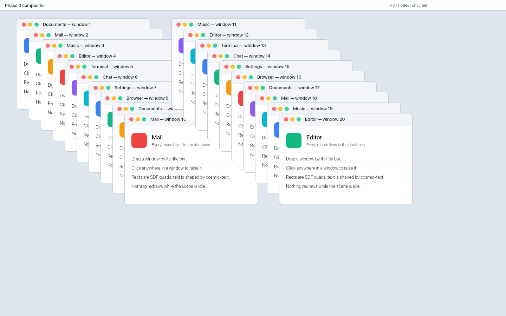

# idealos

A research desktop OS built around one question: what would a desktop look like if a
persistent, versioned, syncable database replaced the filesystem?

It is a minimal Linux with its own hardware-accelerated scene-graph compositor, a
message bus that brokers permissions, a CRDT document database, and TypeScript apps.
Targets: Raspberry Pi 4 (8 GB) and an aarch64 QEMU VM on Apple Silicon.

- [docs/feature-list.md](docs/feature-list.md): vision, decisions, architecture, risks
- [docs/implementation-plan.md](docs/implementation-plan.md): milestones M0–M14
- [docs/spikes.md](docs/spikes.md): spike results (database and QuickJS so far)



The same compositor on the QEMU image, through its KMS backend:
[docs/screenshots/m1-kms-qemu.png](docs/screenshots/m1-kms-qemu.png).

## Quick start (macOS)

```sh
make hosted        # compositor demo in a window: drag title bars, click to raise, Option+Tab
make bench         # release build, redraws every frame, logs frame times
make bus           # the message bus broker; then, in another terminal:
make bus-bench     #   round trip and throughput through it (osctl bus bench)
make spike-db      # Spike C: Loro + SQLite + FTS5 at 10,000 docs
make spike-js      # Spike D: memory and startup of 8 QuickJS app processes
make spike-kms     # Spike A: wgpu -> KMS on virtio-gpu in a QEMU VM (needs lima + qemu)
make screenshot    # render the demo offscreen to docs/screenshots/phase0.png
make test          # all Rust tests (includes a real GPU render-and-readback test)
make lint          # rustfmt, clippy, and the device-only compositor build
make lint-device   # clippy on the Linux-only KMS code, in the build VM
make sdk           # type-check the TypeScript SDK
make tools-check   # type-check and unit-test the TypeScript tools in tools/
```

Device images need two extra tools: `brew install lima qemu`.

```sh
make vm            # create the aarch64 Linux build VM (once)
make check-defconfigs  # seconds: fail if Buildroot would silently drop a defconfig option
make image-qemu    # Buildroot image for QEMU  -> image/output/qemu (first build ~3 h)
make smoke-qemu    # boot it headless and check it, input included (~20 s); exits 1 on any failure
make smoke-deploy  # ...then rebuild the binaries, deploy them over SSH, check the restart
make smoke-report  # ...then run the Pi's first-boot hardware report against it
make qemu          # boot it; serial console here, display in a window
make image-rpi4    # Buildroot image for the Pi -> image/output/rpi4
tools/flash-sd /dev/diskN
make deploy HOST=idealos.local          # rebuild and push binaries to a running dev image
make deploy HOST=localhost PORT=2222   # ...or to QEMU
make pi-report HOST=idealos.local       # hardware report + Spike A-D numbers -> image/output/reports
```

`tools/build-image` makes an SSH key, `image/output/dev-key`, and bakes its public
half into dev images as root's only login. `make deploy` uses it, so reflash after
deleting `image/output`. Deploy builds with the image's own Buildroot toolchain
(`make device-bins`), copies the binaries to the writable `/opt/idealos/bin` overlay,
and sends `session` SIGTERM; init restarts it and it prefers the overlay's binaries.

On a new board, run `make pi-report` first. It records the board, storage speed, DRM
cards and connectors, Vulkan drivers and input devices, then stops the desktop to run
kms-probe with two and three buffers (Spikes A/B), runs the compositor flat out for
10 s, runs both benchmarks (Spikes C and D), and restores the desktop. A copy stays
on the device in `/data/reports`.

## Layout

```
crates/protocol     bus envelope and scene-graph ops (shared by Rust and, via sdk/, TypeScript)
crates/busd         message bus broker: routing, pub/sub, sender identity, permission hook
crates/bus-client   async Rust client for the bus
crates/osctl        command-line tool: osctl bus list|call|pub|sub|tap|echo|bench
crates/compositor   scene graph, wgpu renderer, window manager, hosted + KMS backends
crates/session      first process after init: starts and supervises services
spikes/             db-bench (C), js-bench (D), kms-probe (A/B): benchmarks to rerun on the Pi
sdk/                @idealos/sdk (wire types today; bus, db, signals and widgets in M4)
image/              Buildroot external tree: defconfigs, kernel fragments, rootfs overlay
tools/              build VM, image build, QEMU, SD card, deploy scripts
docs/               feature list, implementation plan, screenshots
```

## Status: Phase 0

| Item | State |
| --- | --- |
| Monorepo, Makefile, CI workflow | Done. CI runs on GitHub (`IdealOS/m7`) and passes. |
| `protocol`: bus envelope, framing, scene ops | Done, tested against the plan's JSON examples |
| Compositor scene graph (groups, rects, text, clipping) | Done, tested |
| Renderer: instanced SDF rounded rects, glyphon text per layer | Done; renders at 60 fps hosted on an M3 |
| Window manager v0: raise on click, drag by title bar, Alt+Tab | Done, tested. Both backends feed one `Seat`, so mouse, tablet and keyboard drive the same code. |
| Damage tracking | Frame-level only: an idle scene draws nothing. Region damage is still to do. |
| Headless render to PNG | Done (screenshots, future golden-image tests) |
| `session` supervisor with restart backoff | Done, tested on macOS. Stops its services on SIGTERM (SIGKILL after 2 s), so a restart leaves nothing behind. |
| Bundled UI font | Done: Inter (variable, SIL OFL) is built into the compositor as the sans-serif face on every target; system fonts are only fallbacks for other scripts. |
| Images, transforms beyond translation | Not started. |
| KMS backend | **Output and input work** (M1): `compositor --backend kms` draws the scene with three page-flipped dumb buffers (Spike A's copy path), redraws only when the scene changes, and takes keyboard and pointer input through libinput and xkbcommon. The pointer is a hardware cursor, so moving it costs no redraw (checked by eye in QEMU's window; screendumps leave it out). It picks the first DRM card with a connected display (on a Pi 4, `vc4`, not `v3d`). While it runs, the text console's keyboard and drawing are off, so keys don't also reach the console (on the Pi, a root shell); it exits cleanly on SIGTERM and gives them back. Mesa's shader cache lives on `/data/cache`. Not yet: the zero-copy Pi path (Spike B). |
| Buildroot image for QEMU | **Built and booted** (Buildroot 2026.08.2, kernel 6.12.58). Boots to `session` in ~0.4 s under HVF; `/data` and the dev overlay mount; the compositor shows its first frame on virtio-gpu (lavapipe), finds QEMU's virtio keyboard and tablet, and moves a window dragged by its title bar and raises the next on Alt+Tab. `make smoke-qemu` checks all of this. |
| Buildroot image for the Pi | **Built** on the first try (~45 min, reusing downloads): Pi kernel `stable_20250916`, V3DV Vulkan driver, firmware with the `vc4-kms-v3d-pi4` overlay, and the dev SSH key, in a 3.3 GB `sdcard.img`. **Never booted**: no Pi on hand yet. |
| Lima build VM, image build, QEMU boot | Run end to end. |
| SSH deploy | **Works against QEMU**: `make smoke-deploy` rebuilds, pushes, and checks that `session` and the compositor restarted from the overlay with the old shell gone. Not yet run against a Pi. |
| Hardware report (`make pi-report`) | **Works against QEMU**: `make smoke-report` runs it end to end and checks every section, both kms-probe runs, the compositor finding input, both benchmark tables, and that the desktop comes back. Not yet run on a Pi. |
| SD card flashing | `tools/flash-sd` is syntax-checked but **never run**. |

### Message bus (M2)

| Item | State |
| --- | --- |
| `busd` broker | **Works** on macOS and in the QEMU image, where session starts it on `/run/idealos/bus.sock` and `make smoke-qemu` sends a request through it. Routes requests by service name and rewrites request ids, so two clients can both use id 1. A request ends with exactly one answer: the service's, a broker `timeout` (default 30 s, or `timeout_ms`), `service_gone`, or nothing after the caller cancels. Also handles pub/sub with `prefix.*` wildcards, and stamps every message with its sender (a client's own `from` is dropped). Each connection's outgoing queue is bounded at 4096 frames, 16 MiB and 256 descriptors; a connection that stops reading is dropped, except a tap, which just misses trace messages. Each connection may also have at most 1,024 requests waiting for answers, 256 subscriptions and 64 names (past them the broker answers `limit_exceeded`), and a request waits at most an hour. It raises its own open-descriptor limit at startup (the default is 1,024). The permission hook allows everything until M6. |
| Who may connect | Through the socket: only the broker's own user or root, checked with peer credentials, in an owner-only directory; these connections are trusted (they may claim service names and tap the bus). **Identity by construction:** session starts `busd` with session's own connection already in place (`bus=broker` in `session.conf`), and for each `bus=system` or `bus=app:ID` service makes a socket pair, gives the service one end (`IDEALOS_BUS_FD`) and hands the broker the other with `adopt`, which only session may call. An app's messages are stamped with its app id; it can't claim names or tap. If `busd` dies, session restarts it and the services that had connections. Apps have no sandbox yet (M6), so an app could still reach the socket itself. |
| File descriptors | Requests, responses and publishes can carry up to 16 (`SCM_RIGHTS`), declared as `"fds": n`; each subscriber gets its own copies. A message whose descriptors didn't arrive drops the connection. |
| `bus-client` | Async Rust client: typed `hello`, `list`, `claim` and `release`, requests (dropping one before it finishes cancels it), subscriptions (dropping the last one on a pattern unsubscribes), publishing, serving claimed names, and descriptors on all of them. Uses the connection session handed over when there is one. |
| `osctl bus` | `list`, `hello`, `call`, `pub`, `sub`, `tap` (a live trace of every message), `echo` (a test service), `bench`. |
| Benchmarks | `osctl bus bench`, through a running broker. Apple M3 Mac (release build): 37.5 µs round trip p50, 290,000 requests/s with 64 in flight, 1.24 million publishes/s. QEMU image on the same Mac (`make smoke-report`, 3 s runs): 18.5 µs p50, 262,000 requests/s and 1.47 million publishes/s with 64-byte payloads; 47.7 µs, 124,000 requests/s and 237,000 publishes/s with 4 KiB. `make smoke-qemu` checks a 1 s run. `make pi-report` runs it on a Pi; not yet run there. |
| Schema and TypeScript types | `crates/protocol-schema` exports the wire types (and the protocol's constants and broker error codes) as JSON Schema to `crates/protocol/schema.json`, and `tools/gen-protocol.ts` generates `sdk/src/protocol.ts` from it; `make protocol` does both. The broker's own methods (`hello`, `claim`, `release`, `list`, `adopt`) and the tap's trace events have typed params and results in `protocol::broker`, exported the same way. A Rust test and a tools test fail when either file is out of date. The generator fails on any schema it doesn't understand instead of writing `unknown`. |
| Randomized tests | Seeded, dependency-free, and part of `cargo test`: the router gets random traffic across connections that open, close and get adopted, with its tables checked after every event and every forwarded request checked to end exactly once, answered only by the service it went to; the frame decoder gets random and damaged frames; a live broker gets garbage from 64 connections at once and must keep serving and forget them all. `BUS_FUZZ_SEEDS=n` runs longer: 100,000 router seeds (200 million events) and 50 million damaged frames pass. Planted router bugs are caught. No coverage-guided fuzzing yet (`cargo-fuzz` needs a newer nightly than this machine has). |

### Database (M3)

| Item | State |
| --- | --- |
| Document store (`crates/db`) | **Works** on macOS. Each document is a Loro document; one SQLite transaction (WAL) per change writes its snapshot or incremental update, a JSON copy for queries and an FTS5 row for search, as Spike C measured. Updates are JSON merge patches that write only what changed; updates are folded into the snapshot every 64. Every change belongs to a change set recording when and who. Deleting keeps the state for history. Documents are at most 1 MiB of JSON. |
| Queries | A Mongo-style filter (`$eq`, `$ne`, `$gt`/`$gte`/`$lt`/`$lte`, `$in`, `$nin`, `$exists`, `$contains`, `$and`, `$or`, `$not`) compiled to SQL. Field paths are validated and inlined so expression indexes match (a test checks the query plan); values are always bound. Comparisons are typed. A reference evaluator agrees with the SQL on random documents and filters (100,000 filters pass). Search matches every word, with FTS5 syntax treated as text. |
| `dbd` (the `db` service) | Serves `create`, `get`, `update`, `delete`, `query` and `search` on the bus; records each change under the caller's stamped identity. Session starts it as a system service; the database is `/data/db/idealos.db` on the device. `make db` runs it on the Mac. |
| History and undo | Every change set's effect on each document is kept as Loro versions (schema version 2, migrated from 1). `history` lists a document's changes and `at` reads it as of any of them, even after compaction. `undo` reverts a change set with a new one, so the undo is in history too and undoing it redoes: an update's fields go back (later changes to other fields stay), a create is deleted, a delete restored. A randomized test checks this against a model (1,000 seeds pass). |
| `osctl db` | `create`, `get`, `update`, `delete`, `query`, `search`, `history`, `at`, `changes`, `undo`. |
| Not started | Live queries, links and `$link`, blobs, schemas and expression indexes from them, snapshots, the Pi benchmark. Strings are plain values, not collaborative text, yet. |

### Spikes

| Spike | State |
| --- | --- |
| C: Loro + SQLite + FTS5, 10,000 docs | Measured on the Mac: ~0.1 ms per write, copies never diverge; live queries need expression indexes. Pi run pending. |
| D: 8 QuickJS app processes | Measured on the Mac: ~7.5 MiB and ~10 ms per app; 790k signal updates/s. Pi run pending. |
| A: wgpu to KMS in QEMU | Done, in a stock Ubuntu VM and in the idealos image: lavapipe + dumb-buffer copy + page flip, ~11 ms/frame at 1280x800 with three buffers. virgl isn't in Homebrew QEMU. |
| B: wgpu to KMS on the Pi | Needs a Pi. `make pi-report` runs kms-probe there, with the compositor stopped. |
| E, F: Servo, Gmail OAuth | Not started. Servo needs ~30 GB of free disk; Gmail needs a Google Cloud OAuth client. |

### Image build notes

- Buildroot rejects paths containing spaces, so `tools/build-image` copies the repo into
  the VM and builds there.
- Buildroot silently drops a defconfig option whose dependencies aren't met. The first
  build lost glibc, Rust and the idealos package this way, so run `make check-defconfigs`
  after editing a defconfig.
- `idealos-userspace` is a local package, so Buildroot doesn't vendor its crates;
  its `.mk` runs `cargo vendor` itself. `tools/build-image` cleans it on every build so
  the image always has the current code.
- Buildroot's `<pkg>-rebuild` copies a local package's source again but never deletes
  files, so a moved source file breaks the build. `tools/build-device-bins` mirrors
  the source with `rsync --delete` first, keeping cargo's `target` directory so the
  build stays incremental.
- Buildroot doesn't notice changes to `board/common/busybox.fragment`; rebuild BusyBox
  with `tools/build-image qemu busybox-dirclean all`.
- The root filesystem is read-only, so dropbear's host keys live on `/data`
  (`/etc/dropbear` is a link). They survive reboots but not a reflash.
- The workspace needs Rust 1.90 or newer (edition 2024; cosmic-text needs 1.89 and
  ordered-float 1.90). Buildroot 2026.08 ships 1.97; the 2026.02 LTS branch is stuck on
  1.88, so `tools/build-image` defaults to 2026.08.2.
