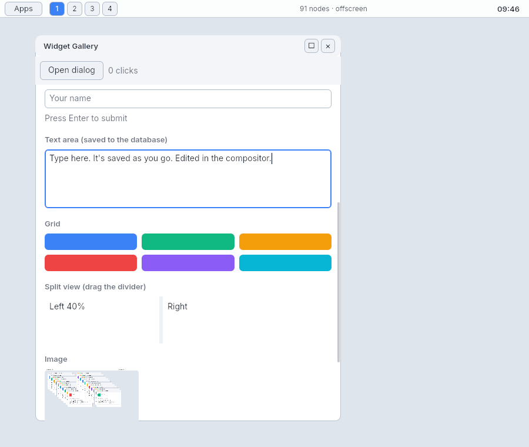
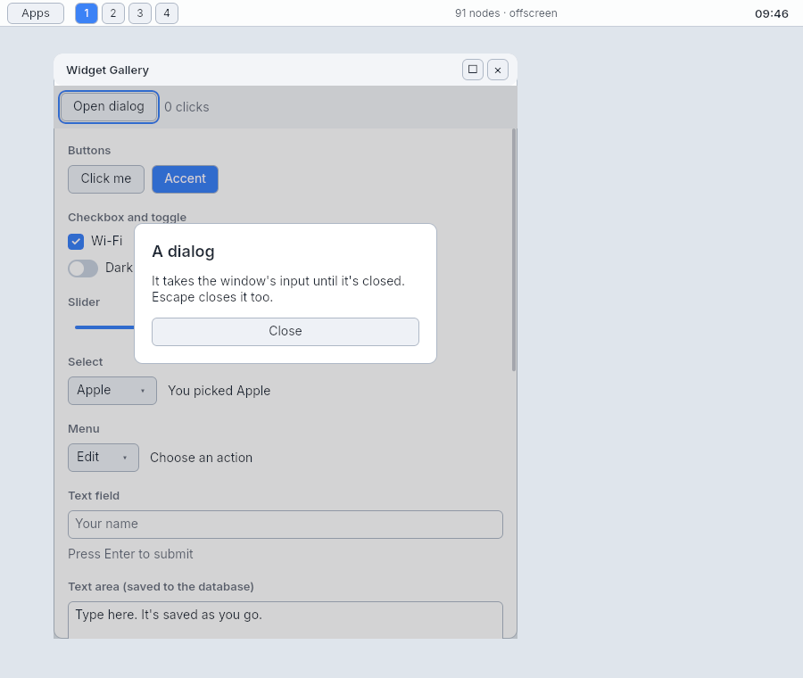

# idealos

A research desktop OS built around one question: what would a desktop look like if a
persistent, versioned, syncable database replaced the filesystem?

It is a minimal Linux with its own hardware-accelerated scene-graph compositor, a
message bus that brokers permissions, a CRDT document database, and TypeScript apps.
Targets: Raspberry Pi 4 (8 GB) and an aarch64 QEMU VM on Apple Silicon.

- [docs/feature-list.md](docs/feature-list.md): vision, decisions, architecture, risks
- [docs/implementation-plan.md](docs/implementation-plan.md): milestones M0–M14
- [docs/spikes.md](docs/spikes.md): spike results (database and QuickJS so far)


The same compositor on the QEMU image, through its KMS backend:
[docs/screenshots/m1-kms-qemu.png](docs/screenshots/m1-kms-qemu.png). Apps in
windows, with the widget set and the shell (M5):
[docs/screenshots/m5-desktop.png](docs/screenshots/m5-desktop.png).

## Quick start (macOS)

```sh
make hosted        # compositor demo in a window: drag title bars, click to raise, Option+Tab
make bench         # release build, redraws every frame, logs frame times
make bus           # the message bus broker; then, in another terminal:
make bus-bench     #   round trip and throughput through it (osctl bus bench)
make spike-db      # Spike C: Loro + SQLite + FTS5 at 10,000 docs
make spike-js      # Spike D: memory and startup of 8 QuickJS app processes
make spike-kms     # Spike A: wgpu -> KMS on virtio-gpu in a QEMU VM (needs lima + qemu)
make screenshot    # render the demo offscreen to docs/screenshots/phase0.png
make test          # all Rust tests (includes a real GPU render-and-readback test)
make lint          # rustfmt, clippy, and the device-only compositor build
make lint-device   # clippy on the Linux-only KMS code, in the build VM
make sdk           # type-check the TypeScript SDK and run its tests
make apps          # bundle the apps in apps/ with esbuild (via npx)
make tools-check   # type-check and unit-test the TypeScript tools in tools/
```

Apps on the Mac, in four terminals: `make bus`, `make db`, `make hosted`, then
`cargo build -p app-host && cargo run -p osctl -- app install --watch apps/notes`.
With no session on the bus, `osctl` runs the app itself, and `--watch` rebuilds
and restarts it whenever the app or the SDK changes.

Device images need two extra tools: `brew install lima qemu`.

```sh
make vm            # create the aarch64 Linux build VM (once)
make check-defconfigs  # seconds: fail if Buildroot would silently drop a defconfig option
make image-qemu    # Buildroot image for QEMU  -> image/output/qemu (first build ~3 h)
make smoke-qemu    # boot it headless and check it, input included (~20 s); exits 1 on any failure
make smoke-deploy  # ...then rebuild the binaries, deploy them over SSH, check the restart
make smoke-report  # ...then run the Pi's first-boot hardware report against it
make qemu          # boot it; serial console here, display in a window
make image-rpi4    # Buildroot image for the Pi -> image/output/rpi4
tools/flash-sd /dev/diskN
make deploy HOST=idealos.local          # rebuild and push binaries to a running dev image
make deploy HOST=localhost PORT=2222   # ...or to QEMU
make pi-report HOST=idealos.local       # hardware report + Spike A-D numbers -> image/output/reports
```

`tools/build-image` makes an SSH key, `image/output/dev-key`, and bakes its public
half into dev images as root's only login. `make deploy` uses it, so reflash after
deleting `image/output`. Deploy builds with the image's own Buildroot toolchain
(`make device-bins`), copies the binaries to the writable `/opt/idealos/bin` overlay,
and sends `session` SIGTERM; init restarts it and it prefers the overlay's binaries.

On a new board, run `make pi-report` first. It records the board, storage speed, DRM
cards and connectors, Vulkan drivers and input devices, then stops the desktop to run
kms-probe with two and three buffers (Spikes A/B), runs the compositor flat out for
10 s, runs both benchmarks (Spikes C and D), and restores the desktop. A copy stays
on the device in `/data/reports`.

## Layout

```
crates/protocol     bus envelope and scene-graph ops (shared by Rust and, via sdk/, TypeScript)
crates/busd         message bus broker: routing, pub/sub, sender identity, permission hook
crates/bus-client   async Rust client for the bus
crates/osctl        command-line tool: osctl bus ..., db ..., app ...
crates/db           the document store: Loro, SQLite, queries, live queries, links, blobs, schemas
crates/dbd          the db service on the bus
crates/app-host     one app's process: its JavaScript in QuickJS, with the bus
crates/compositor   scene graph, wgpu renderer, window manager, hosted + KMS backends
crates/session      first process after init: starts and supervises services
spikes/             db-bench (C), js-bench (D), kms-probe (A/B): benchmarks to rerun on the Pi
sdk/                @idealos/sdk: bus, database and live queries, signals, windows and widgets
apps/               the apps that ship with the system (counter, notes, gallery)
schemas/            JSON Schemas for the system document types
image/              Buildroot external tree: defconfigs, kernel fragments, rootfs overlay
tools/              build VM, image build, QEMU, SD card, deploy scripts
docs/               feature list, implementation plan, screenshots
```

## Status: Phase 0

| Item | State |
| --- | --- |
| Monorepo, Makefile, CI workflow | Done. CI runs on GitHub (`IdealOS/m7`) and passes. |
| `protocol`: bus envelope, framing, scene ops | Done, tested against the plan's JSON examples |
| Compositor scene graph (groups, rects, text, clipping) | Done, tested |
| Renderer: instanced SDF rounded rects, glyphon text per layer | Done; renders at 60 fps hosted on an M3 |
| Window manager v0: raise on click, drag by title bar, Alt+Tab | Done, tested. Both backends feed one `Seat`, so mouse, tablet and keyboard drive the same code. |
| Damage tracking | Frame-level only: an idle scene draws nothing. Region damage is still to do. |
| Headless render to PNG | Done (screenshots, future golden-image tests) |
| `session` supervisor with restart backoff | Done, tested on macOS. Stops its services on SIGTERM (SIGKILL after 2 s), so a restart leaves nothing behind. |
| Bundled UI font | Done: Inter (variable, SIL OFL) is built into the compositor as the sans-serif face on every target; system fonts are only fallbacks for other scripts. |
| Images, transforms beyond translation | Not started. |
| KMS backend | **Output and input work** (M1): `compositor --backend kms` draws the scene with three page-flipped dumb buffers (Spike A's copy path), redraws only when the scene changes, and takes keyboard and pointer input through libinput and xkbcommon. The pointer is a hardware cursor, so moving it costs no redraw (checked by eye in QEMU's window; screendumps leave it out). It picks the first DRM card with a connected display (on a Pi 4, `vc4`, not `v3d`). While it runs, the text console's keyboard and drawing are off, so keys don't also reach the console (on the Pi, a root shell); it exits cleanly on SIGTERM and gives them back. Mesa's shader cache lives on `/data/cache`. Not yet: the zero-copy Pi path (Spike B). |
| Buildroot image for QEMU | **Built and booted** (Buildroot 2026.08.2, kernel 6.12.58). Boots to `session` in ~0.4 s under HVF; `/data` and the dev overlay mount; the compositor shows its first frame on virtio-gpu (lavapipe), finds QEMU's virtio keyboard and tablet, and moves a window dragged by its title bar and raises the next on Alt+Tab. `make smoke-qemu` checks all of this. |
| Buildroot image for the Pi | **Built** on the first try (~45 min, reusing downloads): Pi kernel `stable_20250916`, V3DV Vulkan driver, firmware with the `vc4-kms-v3d-pi4` overlay, and the dev SSH key, in a 3.3 GB `sdcard.img`. **Never booted**: no Pi on hand yet. |
| Lima build VM, image build, QEMU boot | Run end to end. |
| SSH deploy | **Works against QEMU**: `make smoke-deploy` rebuilds, pushes, and checks that `session` and the compositor restarted from the overlay with the old shell gone. Not yet run against a Pi. |
| Hardware report (`make pi-report`) | **Works against QEMU**: `make smoke-report` runs it end to end and checks every section, both kms-probe runs, the compositor finding input, both benchmark tables, and that the desktop comes back. Not yet run on a Pi. |
| SD card flashing | `tools/flash-sd` is syntax-checked but **never run**. |

### Message bus (M2)

| Item | State |
| --- | --- |
| `busd` broker | **Works** on macOS and in the QEMU image, where session starts it on `/run/idealos/bus.sock` and `make smoke-qemu` sends a request through it. Routes requests by service name and rewrites request ids, so two clients can both use id 1. A request ends with exactly one answer: the service's, a broker `timeout` (default 30 s, or `timeout_ms`), `service_gone`, or nothing after the caller cancels. Also handles pub/sub with `prefix.*` wildcards, and stamps every message with its sender (a client's own `from` is dropped). Each connection's outgoing queue is bounded at 4096 frames, 16 MiB and 256 descriptors; a connection that stops reading is dropped, except a tap, which just misses trace messages. Each connection may also have at most 1,024 requests waiting for answers, 256 subscriptions and 64 names (past them the broker answers `limit_exceeded`), and a request waits at most an hour. A **streamed request** (`"stream": true`) instead gets any number of `stream` frames from the service before its response, has no timeout, and ends when the service responds, the caller cancels, or either side disconnects (each connection may have 256 open, apart from the 1,024). It raises its own open-descriptor limit at startup (the default is 1,024). The permission hook allows everything until M6. |
| Who may connect | Through the socket: only the broker's own user or root, checked with peer credentials, in an owner-only directory; these connections are trusted (they may claim service names and tap the bus). **Identity by construction:** session starts `busd` with session's own connection already in place (`bus=broker` in `session.conf`), and for each `bus=system` or `bus=app:ID` service makes a socket pair, gives the service one end (`IDEALOS_BUS_FD`) and hands the broker the other with `adopt`, which only session may call. An app's messages are stamped with its app id; it can't claim names or tap. If `busd` dies, session restarts it and the services that had connections. Apps have no sandbox yet (M6), so an app could still reach the socket itself. |
| File descriptors | Requests, responses and publishes can carry up to 16 (`SCM_RIGHTS`), declared as `"fds": n`; each subscriber gets its own copies. A message whose descriptors didn't arrive drops the connection. |
| `bus-client` | Async Rust client: typed `hello`, `list`, `claim` and `release`, requests (dropping one before it finishes cancels it), streamed requests (dropping the stream cancels it), subscriptions (dropping the last one on a pattern unsubscribes), publishing, serving claimed names (and streaming answers), and descriptors on all of them. It refuses to send a message over the broker's 4 MiB frame limit (`limit_exceeded`) rather than lose the connection. Uses the connection session handed over when there is one. |
| `osctl bus` | `list`, `hello`, `call`, `stream` (a streamed request, one JSON line per part), `pub`, `sub`, `tap` (a live trace of every message), `echo` (a test service), `bench`. |
| Benchmarks | `osctl bus bench`, through a running broker. Apple M3 Mac (release build): 37.5 µs round trip p50, 290,000 requests/s with 64 in flight, 1.24 million publishes/s. QEMU image on the same Mac (`make smoke-report`, 3 s runs): 18.5 µs p50, 262,000 requests/s and 1.47 million publishes/s with 64-byte payloads; 47.7 µs, 124,000 requests/s and 237,000 publishes/s with 4 KiB. `make smoke-qemu` checks a 1 s run. `make pi-report` runs it on a Pi; not yet run there. |
| Schema and TypeScript types | `crates/protocol-schema` exports the wire types (and the protocol's constants and broker error codes) as JSON Schema to `crates/protocol/schema.json`, and `tools/gen-protocol.ts` generates `sdk/src/protocol.ts` from it; `make protocol` does both. The broker's own methods (`hello`, `claim`, `release`, `list`, `adopt`) and the tap's trace events have typed params and results in `protocol::broker`, exported the same way. A Rust test and a tools test fail when either file is out of date. The generator fails on any schema it doesn't understand instead of writing `unknown`. |
| Randomized tests | Seeded, dependency-free, and part of `cargo test`: the router gets random traffic across connections that open, close and get adopted, with its tables checked after every event and every forwarded request checked to end exactly once, answered only by the service it went to, with stream frames reaching only the requester of an open streamed request; the frame decoder gets random and damaged frames; a live broker gets garbage from 64 connections at once and must keep serving and forget them all. `BUS_FUZZ_SEEDS=n` runs longer: 100,000 router seeds (200 million events) and 50 million damaged frames pass. Planted router bugs are caught. No coverage-guided fuzzing yet (`cargo-fuzz` needs a newer nightly than this machine has). |

### Database (M3)

| Item | State |
| --- | --- |
| Document store (`crates/db`) | **Works** on macOS. Each document is a Loro document; one SQLite transaction (WAL) per change writes its snapshot or incremental update, a JSON copy for queries and an FTS5 row for search, as Spike C measured. Updates are JSON merge patches that write only what changed; updates are folded into the snapshot every 64. Every change belongs to a change set recording when and who. Deleting keeps the state for history. Documents are at most 1 MiB of JSON. |
| Queries | A Mongo-style filter (`$eq`, `$ne`, `$gt`/`$gte`/`$lt`/`$lte`, `$in`, `$nin`, `$exists`, `$contains`, `$and`, `$or`, `$not`, and the link operators below) compiled to SQL. Field paths are validated and inlined so expression indexes match (a test checks the query plan); values are always bound. Comparisons are typed. A reference evaluator agrees with the SQL on random documents and filters (100,000 filters pass). Search matches every word, with FTS5 syntax treated as text. |
| `dbd` (the `db` service) | Serves documents, queries, search, history, `watch`, links, snapshots and blobs on the bus; records each change under the caller's stamped identity. Session starts it as a system service; on the device the database is `/data/db/idealos.db`, with `snapshots/` and `blobs/` beside it. `make db` runs it on the Mac. |
| History and undo | Every change set's effect on each document is kept as Loro versions. `history` lists a document's changes, `at` reads it as of any of them (even after compaction), and `diff` lists the fields that differ between two. `undo` reverts a change set with a new one, so the undo is in history too and undoing it redoes: an update's fields go back (later changes to other fields stay), a create is deleted, a delete restored. A randomized test checks this against a model (1,000 seeds pass). |
| Live queries | `watch` takes a query as a streamed request. The first part is the result; each later part is a diff (`added`, `changed`, `removed`, and the full `order` whenever something was added or moved). Writes collect for 16 ms, so a burst of writes is one part (21 writes arrived as 2 in the test). Then a live query re-runs only if a changed document was in its last result or matches its filter now, checked with the query's own SQL limited to the changed rows (queries with an offset always re-run): in the benchmark, 2,036 of 2,500 candidate re-runs were skipped, and refreshing 20 live queries after a write fell from 126 ms to under 1.5 ms on the Mac. Cancelling or disconnecting stops it; dbd keeps at most 4,096. A randomized test applies every part to a client's copy and checks it against running the query again (2,000 seeds pass, including offsets, and planted bugs in the diff and in the skip rule are caught). Not yet: sharing one run between identical queries. |
| Links | A field whose value is `{"$link": "<id>"}` links to that document. Links live in the document's data, so history, undo and sync carry them; each write also rewrites the document's rows in a `links` table (schema version 3), so they're followed both ways: `links` lists a document's links out and in (and whether each target exists), and filters match `{"from": {"$link": id}}` (that field, a field under it or an item of it), `{"$linksTo": id}` and `{"$linkedFrom": id}`. Targets may be missing; a deleted document's links leave until it's restored. A randomized test checks the table always matches the documents through creates, updates, deletes and undos. Graph queries are one hop for now. |
| Blobs | Immutable files named by their SHA-256 (`blobs/ab/cdef…`, read-only), stored once however often they're added. `put_blob` takes a regular file or memfd as a passed descriptor and is read off the store's thread; `get_blob` answers with a read-only descriptor. Documents refer to them with `{"$blob": "<hash>"}`, only to stored ones, and `blob_info` counts the live references. SHA-256 is our own 120 lines, checked against the NIST vectors, instead of a dependency. Deleting unused blobs waits for history compaction (M8), since old versions may still need them. |
| System schemas | `schemas/` holds JSON Schemas for App, Contact, Email, Image, Message, Playlist, Setting, TextDocument and Track. Writes of those types are checked (unknown fields allowed; other types are free-form), and each schema's `x-indexes` become `(type, field)` expression indexes, which the compiled queries use. dbd checks the subset of JSON Schema they use itself, and a schema using anything else fails a test, so no keyword is silently ignored. `schemas` returns them. |
| Snapshots | dbd takes one an hour (none if nothing changed) with SQLite's online backup API, keeping 48; `snapshot` takes one now and `snapshots` lists them. `restore` copies one back over the live database after saving the current state as a snapshot, so a restore can be undone; it refuses damaged snapshots, ones from a newer build and ones from another device, migrates older ones, and live queries re-run against the restored data. |
| `osctl db` | `create`, `get`, `update`, `delete`, `query`, `search`, `history`, `at`, `diff`, `changes`, `undo`, `watch` (prints the parts as JSON lines; `--count N` stops after N), `link`, `links`, `schemas`, `snapshot`, `snapshots`, `restore`, `put-blob`, `get-blob`, `blob-info`. |
| Benchmark (`make db-bench`) | `store-bench` fills a fresh store with 10,000 emails (~2 KB bodies, each linked to a Contact) and times creates, updates, old versions, undo, live query refreshes, queries through the filter language and schema indexes, link queries, search, snapshots and blobs, checking the copies agree. `make pi-report` runs it on the device. Apple M3 Mac: create 0.44 ms and update 0.39 ms p50; inbox query 0.6 ms; all 825 mail from one sender 13 ms; rare-word search 0.3 ms; snapshot of the 96 MB database 0.25 s; blobs at 150 MB/s. The QEMU image on the same Mac (`make smoke-report`, which runs it through the hardware report): create 0.25 ms, update 0.28 ms, live refresh after a write 1.1 ms, all mail from one sender 8.7 ms, snapshot 0.1 s. SQLite's planner needs statistics to pick the right expression index (one query went from 38 ms to 13 ms), so the store runs `PRAGMA optimize` when it opens and dbd hourly. |
| Not done | The Pi benchmark (no Pi yet). |
| Collaborative text | `splice` (M5) edits a string field as Loro text: an insert and delete at a character position, which merges with other edits instead of replacing the string. |

### App runtime (M4)

| Item | State |
| --- | --- |
| Compositor on the bus | **Works** hosted and in the QEMU image. It claims `compositor` on a bus thread that hands requests to the frame loop and wakes it (a winit user event hosted, a socket pair in the KMS loop's `poll`), so rendering never waits on I/O. `open_window` is a streamed request: its first part names the window, later parts are the window's events, and the window lasts exactly as long as the request, so an app that exits or crashes leaves nothing behind. Each window gets a frame the compositor draws (title, close button) and a content area. Apps name nodes with their own ids, translated per window, so an app reaches only its own nodes; a commit is checked whole before any of it applies, only the window's opener may commit to it, and a window holds at most 20,000 nodes. |
| Widgets so far | `vstack` and `hstack` lay out their children (`gap`, `padding`, sizes from props or content); `label`; `button`, drawn pressed while held, with clicks sent to the app; `rect`, `text`, `group`. Presses go to the topmost window only. New windows open side by side, then in rows. M5 replaced this with taffy layout and the full widget set (below). |
| `app-host` | One process per app: QuickJS (rquickjs) runs the app's bundle as an ES module after a prelude that provides `console`, timers and `__idealos` (requests, streamed requests and cancels on the bus). Everything runs on one thread; JavaScript and Rust exchange only ids and JSON. It ends when the app exits or has nothing left to wait for; errors in callbacks are logged and the app carries on. 256 MB heap limit. |
| `@idealos/sdk` | `request`/`stream`; `db` (`query`, `get`, `put`, `update`, `remove`, `search`, and `live`, a signal that follows `watch`); SolidJS-style `signal`, `effect`, `memo`, `batch`, `root`; `openWindow`, `vstack`, `hstack`, `label`, `button`, `rect`, and `each` for keyed lists. UI is built once; function-valued props are reactive, only changed values are sent, and ops go out as one commit per microtask. Tested against a fake app-host (`sdk/check`). |
| Apps | `apps/counter` and `apps/notes` (a live list of Notes that can add one). `tools/build-app.ts` bundles an app with esbuild (via npx, pinned to 0.28.2, so nothing is installed in the repo) into `dist/app.js` and `dist/manifest.json`. |
| Installing and launching | An installed app is an `App` document whose bundle is a blob. `osctl app install DIR [--watch]` builds, installs and asks session to `launch` it; session runs `app-host --app ID` with an `app:ID` bus connection and restarts it like a service (`stop` and `apps` too; only trusted connections may call them). The image ships the apps under `/usr/share/idealos/apps`; `app-host --install` puts them in the database at boot and launches the autostart ones. |
| Tests | An end-to-end test runs a real broker, dbd, the compositor's bus bridge and an app in app-host, clicks the app's button through the compositor's input path and reads the result off the scene. Visual check: `compositor --screenshot out.png --serve-for N --click LABEL` serves app windows on the bus, presses buttons and renders. The QEMU smoke test checks that session runs both apps and that they opened their windows under their own app ids. |
| Not done | Memory per app process on the Pi (no Pi yet). App bundles aren't signed, and apps have no permissions or sandbox yet (M6). |

### Widgets and window manager (M5)

| Item | State |
| --- | --- |
| Layout | **taffy** (flexbox and grid) lays out every container: `vstack`, `hstack`, `toolbar`, `grid` (`columns`), `split`, `scroll` and `dialog`, with `gap`, `padding`, `align`, fixed or percentage sizes, and `grow`. Text is measured with cosmic-text using the renderer's own metrics, so what's measured is what's drawn. Layout runs only when a commit changes something that affects it; colors, pressed states, carets and scroll offsets skip it. |
| Widgets | `label`, `button`, `checkbox`, `toggle`, `slider`, `select` (a menu of options that keeps a value), `menu` (a button that opens a menu of actions), `text_field`, `text_area` (multiline, wrapping), `image` (a PNG blob), `scroll` (wheel, trackpad, and drag with kinetic coasting), `vlist` (a virtual list: the app makes only the rows in view, told which by `range` events), `split` (a draggable divider), `toolbar` and `dialog` (modal within its window; Escape cancels). The compositor draws and drives them all: typing, dragging a slider, scrolling and opening menus never wait on the app, which hears `click`, `change`, `submit`, `choose`, `range` and `cancel` events. Widget state the compositor owns (focus, caret, selection, scroll position) lives in `_`-prefixed props that apps can't set. |
| Focus and keyboard | Clicking focuses a widget; Tab and Shift+Tab move through a window's focusable widgets in order; focus is drawn as a ring. Space or Enter works buttons, checkboxes, toggles, selects and menus; arrows, Page Up/Down, Home and End move sliders and selects; text widgets have caret movement, selection (Shift+arrows, drag, select all) and cut, copy and paste with Ctrl (Linux) or Cmd (Mac). |
| Bound text | A `text_field` or `text_area` with `bind: {doc, path}` edits that document field directly: the compositor loads it from `dbd` and sends each edit as a `splice` (insert and delete at a character position), which dbd applies to the field as Loro collaborative text, with no round trip through the app. An end-to-end test types into a bound text area, restarts dbd, the compositor and the app, and finds the text again. |
| Clipboard | Owned by the compositor: text plus an optional document reference. Text widgets use it directly; apps read and write it with `get_clipboard` and `set_clipboard` (`clipboard()` and `setClipboard()` in the SDK). |
| Window manager | Compositor-drawn title bars with close and maximize buttons. Drag the title bar to move, the bottom-right corner to resize (the app hears the new size once, as `resized`), and maximize with the button, Ctrl+Alt+Up or Logo+Up. Clicking raises and focuses a window. Four workspaces: Ctrl+Alt+Left/Right or Ctrl+Alt+1–4 switch, and adding Shift takes the top window along; new windows open on the current one. Alt+Tab (or Logo+Tab) raises the next window and briefly shows a switcher listing them. |
| Shell | In the top bar: an Apps button whose menu lists the installed `App` documents and launches the one chosen (through session), one button per workspace with the current one highlighted, and a clock in local time. |
| Theme | Colors, spacing, sizes and radii are tokens in `crates/compositor/src/theme.rs`; apps can name a color token as `$name` (such as `$accent`). |
| Gallery app | `apps/gallery` shows every widget, with a text area bound to a "Gallery scratchpad" note. It's installed in the image but doesn't start on its own: launch it from the Apps menu. Visual check: `compositor --screenshot out.png --serve-for N` now also takes `--type TEXT`, `--key NAME` and `--scroll PX` steps beside `--click LABEL`. |
| SDK | Builders for every widget above, `onChange`/`onSubmit`/`onChoose`/`onCancel`/`onRange` handlers, `virtualList({count, rowHeight, overscan}, render)`, and a window `size()` that follows resizes. |
| Not done | Bound fields load once: changes another writer makes to the same field don't show until the field is made again (live bound fields need `watch` on the field). Only PNG images (at most 4096 px on a side). The clipboard lives in memory and any app may read it until permissions arrive (M6). The KMS backend's new keyboard, wheel and wake handling is checked by clippy and the QEMU smoke test, not by hand on a Pi. |

Screenshots, rendered offscreen by `compositor --screenshot` while it served real
apps (busd, dbd and app-host running) and played clicks, typing and scrolling:

| | |
| --- | --- |
|  |  |
| Three apps on one workspace; the Apps menu lists the installed `App` documents. | The gallery after clicks, a select, a menu action and typing. |
|  |  |
| Scrolled: the bound text area (typed into by the compositor), grid, split view and an image blob. | A dialog over its window. |

### Spikes

| Spike | State |
| --- | --- |
| C: Loro + SQLite + FTS5, 10,000 docs | Measured on the Mac: ~0.1 ms per write, copies never diverge; live queries need expression indexes. Pi run pending. |
| D: 8 QuickJS app processes | Measured on the Mac: ~7.5 MiB and ~10 ms per app; 790k signal updates/s. Pi run pending. |
| A: wgpu to KMS in QEMU | Done, in a stock Ubuntu VM and in the idealos image: lavapipe + dumb-buffer copy + page flip, ~11 ms/frame at 1280x800 with three buffers. virgl isn't in Homebrew QEMU. |
| B: wgpu to KMS on the Pi | Needs a Pi. `make pi-report` runs kms-probe there, with the compositor stopped. |
| E, F: Servo, Gmail OAuth | Not started. Servo needs ~30 GB of free disk; Gmail needs a Google Cloud OAuth client. |

### Image build notes

- Buildroot rejects paths containing spaces, so `tools/build-image` copies the repo into
  the VM and builds there.
- Buildroot silently drops a defconfig option whose dependencies aren't met. The first
  build lost glibc, Rust and the idealos package this way, so run `make check-defconfigs`
  after editing a defconfig.
- `idealos-userspace` is a local package, so Buildroot doesn't vendor its crates;
  its `.mk` runs `cargo vendor` itself. `tools/build-image` cleans it on every build so
  the image always has the current code.
- Buildroot's `<pkg>-rebuild` copies a local package's source again but never deletes
  files, so a moved source file breaks the build. `tools/build-device-bins` mirrors
  the source with `rsync --delete` first, keeping cargo's `target` directory so the
  build stays incremental.
- Buildroot doesn't notice changes to `board/common/busybox.fragment`; rebuild BusyBox
  with `tools/build-image qemu busybox-dirclean all`.
- The root filesystem is read-only, so dropbear's host keys live on `/data`
  (`/etc/dropbear` is a link). They survive reboots but not a reflash.
- The workspace needs Rust 1.90 or newer (edition 2024; cosmic-text needs 1.89 and
  ordered-float 1.90). Buildroot 2026.08 ships 1.97; the 2026.02 LTS branch is stuck on
  1.88, so `tools/build-image` defaults to 2026.08.2.
