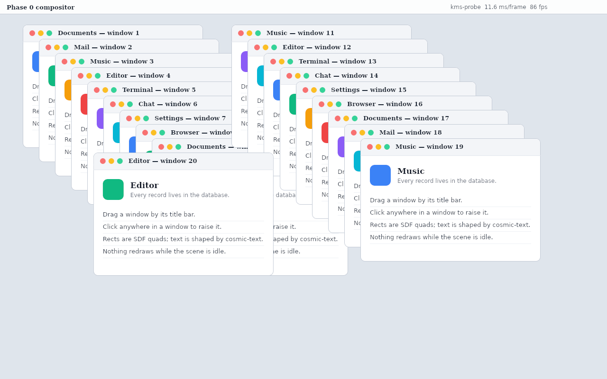

# Spikes

Results of the early spikes from the implementation plan's "First steps". Each spike is a
binary under `spikes/` that prints a Markdown report, so the same command can be rerun on
the Mac, in QEMU and on the Pi and the tables compared. All three binaries ship in the
device images, and `make pi-report HOST=...` runs B, C and D on a board in one go.

| Spike | Question | Status |
| --- | --- | --- |
| A | wgpu to KMS in QEMU (lavapipe dumb-buffer copy, virgl GLES) | **Done (lavapipe copy path)**, in a stock VM and in the idealos image; virgl not available in Homebrew QEMU |
| B | wgpu to KMS on the Pi 4 (V3DV with dmabuf import) | Blocked: needs a Pi (the image is built) |
| C | Loro plus SQLite: writes, JSON copy, FTS5, at 10,000 docs | **Mac done**; Pi pending |
| D | Memory and startup of 8 rquickjs app processes | **Mac done**; Pi pending |
| E | Servo on aarch64, rendering offscreen | Not started: hours of build time (disk is no longer the blocker) |
| F | Gmail OAuth sign-in and one mailbox sync | Not started: needs a Google Cloud OAuth client |

Unless a section says otherwise, numbers are from an Apple M3 on macOS, release build. Expect the Pi 4
(Cortex-A72 at 1.8 GHz, SD card or USB SSD) to be roughly 5–10× slower on CPU-bound rows
and much slower on fsync-bound ones. **The Pi numbers are the ones that decide things;
these only show the design is sound and the benchmark works.**

## Spike A: wgpu to KMS inside QEMU

`tools/spike-kms [--buffers 2|3] [--frames N] [--windows N]` (or `make spike-kms`).

**Setup.** The spike runs in a small Lima VM ([idealos-spike.yaml](../tools/lima/idealos-spike.yaml)),
not in a Buildroot image:

- QEMU 11.1 from Homebrew with HVF acceleration, 4 vCPUs and 4 GiB of RAM;
- stock Ubuntu 26.04 arm64 (kernel 7.0) with a `virtio-gpu-pci` display;
- Mesa 26.0 lavapipe (llvmpipe Vulkan 1.4) from apt.

The guest sees the same `virtio_gpu` DRM device the idealos QEMU image will see. That
answers the spike without the Buildroot build (see "Disk space" below).

**What [kms-probe](../spikes/kms-probe/src/main.rs) does:**

1. Opens `/dev/dri/card0`, finds the connected connector, its preferred mode and a CRTC.
2. Renders the Phase 0 demo (20 windows, 407 nodes) with the real compositor renderer
   into a `Bgra8UnormSrgb` offscreen texture, then reads it back.
3. Copies the rows into an `XRGB8888` dumb buffer (the same bytes on little-endian).
4. Page-flips on vblank, animating a window and the HUD text on every frame.
5. Captures the guest's scanout from the host through QEMU's QMP `screendump`
   ([qmp-screendump.ts](../tools/qmp-screendump.ts)). That proves the pixels reached
   the display, not just a buffer.

Display: `virtio_gpu`, Virtual-1 at 1280×800, 75 Hz (13.3 ms per vblank). 600 frames per run.

| Stage | 2 buffers p50 / p99 | 3 buffers p50 / p99 |
| --- | --- | --- |
| Render + GPU readback (lavapipe) | 9.9 / 16.0 ms | 9.9 / 12.3 ms |
| Copy into dumb buffer | 0.96 / 1.27 ms | 0.96 / 1.20 ms |
| Wait for page flip | 2.4 / 17.2 ms | 2.4 / 3.7 ms |
| **Whole frame** | **13.5 / 30.3 ms** | **13.4 / 14.5 ms** |
| Frame rate | 66.5 fps | **74.6 fps (vsync-locked)** |

Setting up the wgpu device on lavapipe takes 20–40 ms.

### Findings

1. **The copy path works and keeps up.** lavapipe renders the 20-window demo at
   1280×800 in about 10 ms on 4 vCPUs, and the copy into the dumb buffer adds 1 ms.
   - This is the KMS backend's design for QEMU, and the fallback for any GPU that can't
     export dmabufs.
   - The [`Offscreen`](../crates/compositor/src/headless.rs) target used here is the
     same code that renders screenshots.
2. **Use three scanout buffers.** With two, the next frame can't start until the pending
   flip lands, because the only free buffer is still on screen.
   - Any frame that runs over the 13.3 ms vblank period costs a whole extra period.
     That's the 30 ms p99 above.
   - In the first run, with QMP captures competing for CPU, render was about 1 ms
     slower. Every frame missed a vblank, for a steady 38.9 fps.
   - With three buffers the next frame renders while the flip is pending, and the rate
     stays locked at 75 Hz.
3. **virgl isn't an option with stock Homebrew QEMU.** It has `virtio-gpu-pci` but no
   `virtio-gpu-gl` device, because it isn't built with virglrenderer. GPU acceleration
   in the QEMU target would need UTM's QEMU build or a custom one. lavapipe is fast
   enough for development, so this can wait.
4. **No fonts means a panic.** cosmic-text panics ("no default font found") on a system
   with no fonts, which is what a minimal image is.
   - Both Buildroot defconfigs now include DejaVu.
   - Bundling a UI font into the compositor (an open M1 item) would remove the
     dependency, and the compositor should return an error rather than panic.
5. **The 9p mount serves stale files.** Lima's 9p mount for QEMU guests caches
   aggressively. A source edit on the host wasn't visible in the guest. `tools/spike-kms`
   rsyncs the repo into the guest instead, as the build VM scripts already do.
6. **Damage tracking will matter on the copy path.** Every frame here re-renders and
   copies the full screen. With region damage, only changed rows would need copying, and
   the readback could shrink too.

### In the idealos QEMU image

`kms-probe` ships in every image. These numbers come from running it on the
Buildroot 2026.08.2 image (kernel 6.12.58, Mesa 26.1.8, LLVM 22.1.8, lavapipe),
three buffers, before the compositor's KMS backend took over the display (its
display code is now shared with the probe, and `make smoke-qemu` checks the
compositor instead):

| Stage | p50 | p99 |
| --- | --- | --- |
| Render + GPU readback | 10.9 ms | 14.0 ms |
| Copy into dumb buffer | 1.0 ms | 1.7 ms |
| Wait for page flip | 0.0 ms | 0.0 ms |
| **Whole frame** | **12.0 ms** | **15.2 ms** |

Rendering costs about the same as in the Ubuntu VM. The flip wait is zero because QEMU
with `-display none` completes page flips immediately instead of on vblank, so the
~80 fps here is the render-bound rate, not a refresh rate. Use the Ubuntu VM (which has a
VNC display) or real hardware to measure vsync pacing.

Getting the image to build and boot took these fixes, none of which a static review
of the defconfigs would have caught:

- **Silently dropped options.** With headers taken from a custom kernel, Buildroot must
  be told the header series (`BR2_PACKAGE_HOST_LINUX_HEADERS_CUSTOM_6_12`). Without it,
  Buildroot assumed 2.6 headers, so glibc was ruled out, the toolchain fell back to
  uClibc, and Rust and the idealos package were dropped. lavapipe also needs
  `BR2_PACKAGE_MESA3D_LLVM`, and eudev needs `BR2_ROOTFS_DEVICE_CREATION_DYNAMIC_EUDEV`.
  `make check-defconfigs` now fails on any dropped or renamed option.
- **Renamed option.** Mesa's Gallium `SWRAST` driver became `SOFTPIPE`/`LLVMPIPE`;
  the old name stops the build. The image uses llvmpipe.
- **Kernel host tools.** arm64's defconfig builds `certs/extract-cert`, which needs host
  OpenSSL (`BR2_LINUX_KERNEL_NEEDS_HOST_OPENSSL`).
- **Crates for a local package.** Buildroot vendors crates in its download step, which
  local packages skip, then builds `--offline`. `idealos-userspace.mk` runs `cargo vendor`
  in a pre-build hook.
- **Rust version.** The 2026.02 LTS branch ships Rust 1.88; cosmic-text needs 1.89 and
  ordered-float 1.90. The build moved to 2026.08.2 (Rust 1.97.1).
- **Found on first boot:** BusyBox lacked `findfs`, so `/data` never mounted; the Vulkan
  loader (`libvulkan.so.1`) was missing, so wgpu could never have found lavapipe (this
  affects the Pi image too); and the custom `inittab` didn't set the hostname.

The first full build took about 2.5 hours in the build VM (6 vCPUs, 10 GiB), most of it
LLVM, which is built twice (for the host and the target). The build output is about
31 GB in the VM, plus 2 GB of downloads. A 16 GiB VM on a 24 GiB Mac pushed macOS into swap, which comes out of
free disk, so the VM is now 10 GiB.

## Spike C: Loro plus SQLite

`make spike-db` (or `db-bench --docs N --updates N --body-bytes N --db PATH --keep`).

What it does: it follows M3's write path ([store.rs](../spikes/db-bench/src/store.rs)).
Each email is a Loro document. One SQLite transaction (WAL mode, `synchronous=NORMAL`) writes:

- the Loro snapshot (`doc_state`);
- a JSON copy (`doc_json`);
- a contentless FTS5 row.

An edit loads the doc, changes it, appends only the incremental Loro update to `changes`,
and rewrites the JSON and FTS rows. Compaction folds the update log back into a snapshot.
At the end, every JSON copy is checked against its rebuilt Loro doc.

The corpus is 10,000 synthetic emails with ~2 KB bodies and a fixed seed.

| Operation | p50 | p99 | Throughput |
| --- | --- | --- | --- |
| Insert (Loro doc + snapshot + JSON + FTS, 1 txn each) | 0.117 ms | 2.5 ms | 5,200/s |
| Update (load, edit, log update, rewrite JSON + FTS) | 0.120 ms | 4.3 ms | 5,150/s |
| Load doc from snapshot + updates | 0.019 ms | 0.046 ms | 47,000/s |
| Compact one doc | 0.071 ms | 0.087 ms | 13,900/s |

| Query (10,000 docs) | Rows | Median |
| --- | --- | --- |
| Inbox: unread, label INBOX, newest 50, **no index** | 50 | 18.8 ms |
| Same, with a `(type, json_extract(date))` expression index | 50 | 0.21 ms |
| From one sender with one label (full scan) | 120 | 16.6 ms |
| FTS5: one rare word | 50 | 0.12 ms |
| FTS5: two common words, top 50 by bm25 rank | 50 | 7.0 ms |

Other results:

- An average Loro update is 95 bytes; an average snapshot is 2,649 bytes.
- Consistency: 0 JSON copies differed from their Loro doc.
- The database file is 89.8 MB, about 9 KB per doc for ~2.2 KB of content.

### Findings

1. **The dual-copy design holds up.** Keeping the Loro doc and the JSON copy in one
   transaction costs about 0.1 ms per write, and the two copies never diverged. Even at 10×
   slower, the Pi stays well under a frame per interactive edit.
2. **Log updates and compact later; don't rewrite snapshots on every edit.** An update is
   about 28× smaller than a snapshot. Compaction is cheap enough to run during idle time
   or on a document's first load after N updates.
3. **Live queries need indexes.** An unindexed `json_extract` scan of 10,000 docs takes
   about 18 ms here, and probably 100–200 ms on the Pi. That's too slow to re-run on
   every commit. With an expression index, the same query takes 0.2 ms.
   - M3's query compiler should emit SQL that matches expression indexes exactly. The
     schema files should declare which fields get indexes.
   - Queries that can't use an index (such as filtering on array membership alone)
     should be flagged in `osctl db query --explain`.
4. **Storage is about 4× the content.** Body text is stored twice, in the Loro snapshot
   and in the JSON copy, plus the FTS index. That's fine for email at this scale, but it
   matters for a 1 GB mailbox on an SD card. Options to measure later:
   - leave large text fields out of the JSON copy and read them from Loro on demand;
   - enable SQLite page compression.
5. **The p99s are probably fsync.** Insert and update p99s (2–4 ms) are 20–40× the median.
   That fits WAL commits and checkpoints, but I haven't profiled it to confirm.
   - On an SD card this tail will dominate.
   - Bulk imports (first mail sync) should batch many docs per transaction.
   - `dbd` should run checkpoints off the request path.
6. **Gotcha found:** `json_each` has a hidden column named `json`. Inside a
   `json_each(json, ...)` subquery, a bare `json` silently binds to that column, so every
   filter matched nothing. The query compiler must always qualify columns (`doc_json.json`).
   A regression test now checks the SQL queries against an in-memory filter.

## Spike D: QuickJS app processes

`make spike-js` (or `js-bench --processes N --rows N --bundle-kb N --updates N`).

What it does:

- It spawns copies of itself as app processes. Each one starts an rquickjs runtime and
  runs [app.js](../spikes/js-bench/src/app.js), a stand-in for an app plus the SDK:
  - SolidJS-style `signal` and `effect`;
  - 500 labels, each bound to a signal;
  - every change emits a `set` op, batched into one `commit` frame per flush;
  - about 100 KB of extra code, so parse time and bytecode memory are realistic.
- Each process reports how long it took to become ready. The parent reads its resident
  memory.
- Throughput is measured in the parent process.
- A test decodes every frame the app emits with the Rust `protocol` crate. That proves
  the JS side and the compositor's types agree.

| Process | Ready in | RSS | QuickJS heap |
| --- | --- | --- | --- |
| Empty runtime (baseline) | 5.7 ms | 2.4 MiB | 93 KiB |
| App, 500 live labels, 100 KB bundle (each of 8) | 8–17 ms | 7.4 MiB | 1,287 KiB |

Other results:

- All 8 apps were ready in 62 ms, started one after another.
- Total RSS for the 8 apps was 59 MiB, about 5 MiB per app above the empty baseline.
- Signal updates: 790,000 per second. Each update produced a `set` op, and 100,000
  updates came to 6 MB of commit JSON.

### Findings

1. **One process per app is affordable.** At about 7.5 MiB each, 8 apps use about
   60 MiB, under 1% of the Pi's 8 GB, and startup is far below what a person notices.
   Even with a 5–10× slowdown, an app should be ready in under about 200 ms on the Pi.
2. **Signals aren't the bottleneck.** The JS side can produce far more ops than the
   compositor can show in a frame. The limits will be JSON encoding and the bus socket.
   Batch per microtask, as the plan says, and measure bus round trips in M2.
3. **About 60 bytes of JSON per `set` op.** A list that changes 1,000 rows sends about
   60 KB. That's fine over a Unix socket. If profiling ever points at it, a binary
   encoding for scene ops can come later.
4. **Caveat on memory:** on macOS, RSS counts shared library pages in every process. On
   Linux, the spike reads `VmRSS`. Proportional set size (`Pss` in
   `/proc/PID/smaps_rollup`) would give a truer per-app number when 8 apps share the
   same `app-host` binary.

## What these spikes don't tell us yet

- Pi 4 numbers for both spikes. Build both binaries for the image (or deploy them with
  `tools/deploy-to-pi`) and rerun them.
- SD card versus USB SSD fsync behaviour on the Pi, which sets the write p99.
- Live-query re-run cost under a realistic mix of subscribers. That's part of M3.
- QuickJS with ES modules, timers and a real bus socket in the event loop. That's
  `app-host` in M4.
